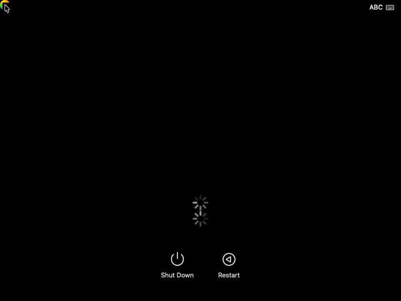

# Elden macOS Recovery bring-up

Related controller, graphics and Recovery implementations are reviewed in
[the pinned project comparison](RELATED-PORTS-20261113.md).

The reference target is macOS 26.5 build 25F71 with XNU 12377.121.6, ARM64e
and 16 KiB pages. Start with the pinned
[macOS-ForSheng 26.5 reference](https://github.com/CrossDarwin/macOS-ForSheng/tree/ca57db73c066162323e77156a9f0f1d72b1de4ff)
on QEMU's ARM `virt` machine. Keep the Elden iPadOS defconfig available
as the device baseline.

## Stage 1 · Linux host and emulator

Passed on 2026-11-10 with x86_64 Arch Linux, Python 3.13.14, Clang/LLD 23.1.1,
QEMU 11.1.1 with TCG, and EDK II 202608.

- ARM64 UEFI reached the boot manager in QEMU.
- Three EL1 cases passed. They exercised the 16 KiB table walk, the forced
  4 KiB fallback control, and exception recovery. All three confirmed PAC
  key switching and restoration for IA, IB, DA, DB and GA.
- Three 47-bit execution cases passed. They exercised instruction fetch,
  the undefined-instruction control, and the execute-never control.
- Elden's iPadOS defconfig resolved and assembled with UniXNU at
  `95ad78129203442c3c14c02336303adbddf8d0a3`. The porting record,
  DTS compilation, and 4 MiB phase-1 FAT payload verification also passed.

From the pinned reference checkout, with Clang, LLD and
`qemu-system-aarch64` on PATH:

```sh
uv venv --python 3.13 .venv
uv pip install --python .venv/bin/python -r requirements.txt -r requirements-test.txt
.venv/bin/python scripts/test_el1_native.py \
  --clang "$(command -v clang)" --qemu "$(command -v qemu-system-aarch64)"
.venv/bin/python scripts/test_el1_native.py --layout47 \
  --clang "$(command -v clang)" --qemu "$(command -v qemu-system-aarch64)"
```

The reference writes logs and `results.json` to `out/el1-native-qemu/` and
`out/el1-layout47-qemu/`. These probes execute on QEMU. Elden's EL1 access,
PAC behavior and translation regime require their own tablet evidence.

## Stage 2 · Paired Recovery inputs

Passed on 2026-11-10. The pinned 25F71 IPSW passed SHA-256, build and board
checks. BaseSystem reported macOS 26.5 build 25F71 and contained ARM64e
`launchd` and `dyld`. The read-only QEMU image is 1,577,092,608 bytes, with
SHA-256 `6199e53d3cf60c59790e507851ef48141dbfa23875fdde5e838446984ed56881`.
The extracted BaseSystem root hash matched the original IPSW manifest.

From the pinned reference checkout, after its core sources are available:

```sh
media=private/apple/macos26
.venv/bin/python scripts/fetch_inputs.py --config config/macos26.json --jobs 8
.venv/bin/python scripts/inspect_macos26.py
.venv/bin/python scripts/prepare_macos26_recovery.py --ipsw-tool "$IPSW_TOOL"
.venv/bin/python scripts/prepare_macos26_block.py --output "$media/recovery-raw"
.venv/bin/python scripts/prepare_macos26_root_hash.py \
  --disk "$media/recovery-raw" --output "$media/BaseSystem.root-hash"
```

Set `IPSW_TOOL` to the executable verified against the reference's
`config/ipsw-tool.json`. The KDK DMG also passed its pinned SHA-256 check.
KDK package signature and kernel UUID checks run on the macOS build host.
See the [pinned reference procedure](https://github.com/CrossDarwin/macOS-ForSheng/blob/ca57db73c066162323e77156a9f0f1d72b1de4ff/docs/bringup.md).

## Stage 3 · Reference Recovery boot in QEMU

The pinned ARM64e XNU source passed preparation with 78 patches. The
DarwinBoot EFI driver built on Linux with Clang/LLD 23.1.1. COFF inspection
confirmed that `DarwinEnter` and `DarwinEnterEnd` share a section, so the
loader can use the end label to bound cache cleaning. The original
function macro put the end label in an empty section that LLD discarded.

After applying the reference's integration patches and building its Mu
BaseTools, apply the Elden compatibility patch and build the loader:

```sh
git -C UniXNU/drivers/DarwinBoot apply \
  "$ELDEN_REPO/patches/macos-recovery/darwinboot-handoff-end-label.patch"
bash scripts/build_native_loader.sh "$LLVM_BIN"
```

Set `ELDEN_REPO` to the device checkout and `LLVM_BIN` to the directory
containing Clang, LLD and the LLVM binary tools. The verified driver is at
`out/native-loader/RELEASE_CLANGPDB/AARCH64/DarwinBoot.efi`, with SHA-256
`810082d8a58723d462a8da5952bb6eabea451eee20e4d9cbaea954d1dcb38a1e`.

The Apple silicon build host verified the Apple KDK package signature
and both matching kernel/DWARF pairs. Xcode 27.0 build `27A5194q` and SDK
27.0 linked the SHENG ARM64e kernel. The Linux host rechecked the kernel,
dSYM UUID, link map, and KDK report after transfer. The kernel UUID is
`4777A227-486E-3F94-8835-7A4CCEB34A38` and its SHA-256 is
`5002cd970525296c7667fff624e31f435ae21f0f2c38c17994ae081159f9069b`.

QEMU reached the real `arm_init` via UEFI and DarwinBoot. The debugger
matched the kernel's instructions at the checkpoint and observed an
enabled EL1 MMU with 16 KiB translation granules and a 47-bit address
regime. The separate raw-entry probe also reached the first C entry.

```sh
.venv/bin/python scripts/observe_macos26_kernel.py \
  --kernel-build "$KERNEL_BUILD" --firmware "$QEMU_EFI" \
  --output out/elden-reference-arm-init --checkpoint arm_init --timeout 75
```

Set `KERNEL_BUILD` to the directory containing the linked kernel, build
record, map and dSYM, and `QEMU_EFI` to the ARM64 UEFI code FD. The
reference's pinned Sheng input archive supplies the QEMU boot manager.

### Recovery userspace

On 2026-11-10, QEMU TCG with one Cortex-A710 and 4 GiB of RAM mounted the
paired APFS BaseSystem over VirtIO and matched the disk's first-sector
hash. The debugger observed the original ARM64e `dyld` entry and matched
the bytes at `launchd`'s `LC_MAIN` entry after its first instruction ran
in EL0. The console reported `recoveryosd` and `coreservicesd` started.
The 180-second run ended at the observation limit.

The guest used the reference's QEMU development-root policy and a separate
ISC test disk with a disposable QCOW2 overlay. The Recovery candidate SHA-256
was `86090c41cdb612d1261f7812504628c930012df60d3dfae084ea1d89098a6026`.
Prepare `ISC_DISK` with the reference's `prepare_qemu_isc.py` on macOS.
Set `ROOT_VOLUME_UUID` to the APFS volume UUID from the paired raw disk.
The observer's `--let-vector-log` option lets XNU handle its initial
synchronous page fault and continue.

```sh
media=private/apple/macos26
candidate=out/elden-reference-recovery-candidate
.venv/bin/python scripts/emit_macos26_security.py \
  --kernel-build "$KERNEL_BUILD" --qemu-only --recovery-components \
  --storage-driver "$KERNEL_BUILD/storage-driver" --output "$candidate"
.venv/bin/python scripts/observe_macos26_kernel.py \
  --kernel-build "$candidate" --firmware "$QEMU_EFI" \
  --output out/elden-reference-launchd --checkpoint thread_setentrypoint \
  --follow-init-entry --follow-launchd-main --continue-after-launchd-main \
  --virtio-block-image "$media/recovery-raw" --root-volume-uuid "$ROOT_VOLUME_UUID" \
  --root-hash-payload "$media/BaseSystem.root-hash" --qemu-development-root --qemu-no-ignition \
  --isc-block-image "$ISC_DISK" --isc-write-overlay \
  --qemu-memory-mib 4096 --owned-memory-mib 2048 --timeout 180 \
  --capture-screen --early-console --boot-progress --let-vector-log
```

The graphical checkpoint remains open. WindowServer started four times
and exited three times. `recoveryosd` reported that `mountrecursive`
exited with status 255. The language chooser had zero starts at the final
sample.

### Elden 4 KiB Recovery Data restore in QEMU

The Elden kernel reproduced the tablet's `restore-datapartition` panic on
QEMU. The guest used the same 25F71 BaseSystem and paired BootKC components,
with a read-only VirtIO root disk and a disposable overlay on the separate
ISC fixture. The guest reached the original `launchd` and ran
`restore-datapartition`. All 18 protected `com.apple.rootless` metadata
copies returned `EPERM`. The older 16 KiB reference passed the copy.

AMFI's CoreEntitlements DER walker used `PAGE_SHIFT_CONST` to estimate
the usable stack below SP. On Elden, a 4 KiB boundary can fall inside a
kernel stack. The estimate returned the stack-protection error (2) for the
original signed wrapper's `com.apple.rootless.install.heritable` query.
Increasing the stack from 16 KiB to 32 or 64 KiB left the error unchanged.

The Elden Recovery prelink now calls a stackless XNU helper that measures
SP against the active thread or interrupt stack. The emitter checks the
paired AMFI module and exact instruction sequence before replacing the
page-based calculation. AMFI retains its original 128-byte threshold,
error branch, signature validation, and entitlement policy.

Build the Elden kernel with `scripts/build-elden-macos26-bootstrap.py`.
The [Elden 4 KiB profile](../configs/elden-macos26-4k.toml) declares
the ARM64e build settings and ordered overlays. The shared SHENG
builder stages XNU and its headers. The Elden profile then supplies
its native page layout, macOS signature and shared-cache handling,
cache verification pipeline, and Recovery diagnostics. Board wiring
comes from the Elden and SM8750 descriptions.

To check the staged sources on Linux or macOS without a KDK:

```sh
python3 scripts/build-elden-macos26-bootstrap.py \
  --sheng-root ../macOS-ForSheng --output-name elden-4k-profile --prepare-only
```

Run the same command again to check an existing source tree without
rewriting unchanged files. The normal kernel build uses the same
profile and adds `--kdk-root` in place of `--prepare-only`. Use a
fresh output name when moving from a legacy build tree or changing
the profile's applied patches.

The first profile build reproduced 6,142 prepared files byte for byte.
Repeated preparation preserved every source timestamp, including with
the USB console and optional Adreno firmware probe. The MacBook linked
the ARM64e kernel with the USB console and the read-only UFS/GOP
companion. The paired 30-module prelink, DarwinBoot preflight, and raw
Android v4 payload readback passed. The MacBook RAM test image is
`~/elden-ptn3222/elden-macos26-4k-profile-ram.img` with SHA-256
`a8e9933b9ba7d156b37b68b83631886439eab535afffd6a326de6e1c8324dfdb`.

On the tablet, that image reached XNU, started the GOP display and read
the UFS manifest. NativeUfs rejected the installed ISC window because the
build had used the reference seed identity. USB captured the complete panic
before the tablet returned to bootloader fastboot.

Rebuild with `--elden-recovery-contract` pointing to the storage contract
that was used to provision Elden. The packed-image verifier's optional
`--recovery-root-pair PRELINK LAYOUT` compares the packaged kernel and
its prelinked OS and ISC identities with the installed layout report. It
also checks that the selected menu entry enables the ISC sidecar. The
verifier rejected the original image and accepted the paired rebuild. The
paired rebuild mounted BaseSystem and ran the original `launchd` through
`main` on the tablet. All seven secondary CPUs came online and the USB
log recorded timer interrupts and IPIs on all eight cores.

On the reference checkout, apply the overlays in order and use the
reference VirtIO companion produced by that build:

```sh
git apply "$ELDEN_REPO/patches/macos-recovery/elden-macos26-prelink-base.patch" \
  "$ELDEN_REPO/patches/macos-recovery/elden-macos26-ce-stack-prelink.patch"
media=private/apple/macos26
.venv/bin/python scripts/emit_macos26_security.py --elden-bootstrap \
  --recovery-components --hid-components \
  --include-module com.apple.iokit.IOMobileGraphicsFamily \
  --include-module com.apple.iokit.IOSurface \
  --include-module com.apple.iokit.IOAVFamily \
  --kernel-build "$KERNEL_BUILD" --storage-driver "$KERNEL_BUILD/storage-driver" \
  --output "$PRELINK"
.venv/bin/python scripts/observe_macos26_kernel.py --elden-bootstrap \
  --kernel-build "$PRELINK" --firmware "$QEMU_EFI" \
  --output out/elden-4k-recovery-data --checkpoint thread_setentrypoint \
  --follow-init-entry --follow-launchd-main --continue-after-launchd-main \
  --virtio-block-image "$media/recovery-raw" --root-volume-uuid "$ROOT_VOLUME_UUID" \
  --root-hash-payload "$media/BaseSystem.root-hash" --qemu-development-root --qemu-no-ignition \
  --isc-block-image "$ISC_DISK" --isc-write-overlay \
  --qemu-memory-mib 4096 --owned-memory-mib 2048 --timeout 240 \
  --early-console --boot-progress --let-vector-log --stream-retained-log
```

Check `stream-console.bin` for the `restore-datapartition` task and a
subsequent `WindowServer` start. `result.json` records the verified 4 KiB
translation regime and the first completed instruction at `launchd` main.
The guest uses the reference's development-root and skip-Ignition settings
with CSR `0x882`. The corresponding tablet run used CSR `0x82`.

The paired QEMU run used the same native kernel, BootKC, VirtIO and media
for both cases. The output images differed only in the eight instructions
that calculate remaining stack space. The original emitted 18 MAC denials
and panicked at `restore-datapartition`. The fixed image
`d050d2f8d1e9b3e6d474cc393cd1217aa8226c529bcf143c256d354a4910dd9d`
returned success for the signed wrapper's entitlement, copied Data with
zero denials, and started `recoveryosd` and WindowServer.
`mountrecursive` later reported missing `imgsrc` device information.
The QEMU run used no display companion. A visible Recovery session and
verification on the tablet remain open.

The native UFS build with the stack fix passed the 30-module prelink,
UFS and display ABI checks, DarwinBoot preflight, and embedded image
verification. The 96 MiB signed image retained the installed Android
boot header and AVB key, salt, rollback settings and boot properties.
The embedded Linux, DTB, and slot and USB EFI binaries matched the
previous `boot_a` byte for byte.

Running slot B Linux, the tablet wrote the fixed image to inactive
`boot_a` over SSH. The backup and full readback were verified. The new
`boot_a` SHA-256 is
`6f5c12cbf18d14e56051d0e97d5cd343ddeeb81a227d01a9ce87fe69580cb06e`.
Slot B remained active on UFS boot LUN 2, and `boot_b` and both
`vbmeta` hashes matched their pre-flash values. Both boot partitions
returned to read-only. The next hardware checkpoint is starting
`recoveryosd` from the installed slot A image.

### Consolidated Recovery menu

The combined Linux and Recovery payload now presents one Recovery test,
**Elden macOS 26.5 - Recovery**. It requests the authenticated Elden
skip-Ignition path, enables the ISC sidecar and volatile overlay, and
shows framebuffer progress. USB logs remain available through entry ID
`recovery-usb`. The entry omits the USB host timeout and retains the
900-second test deadline. Linux and the boot controls remain available
in the same menu, which waits for manual selection.

The updated signed slot A image passed packed payload and AVB verification
at SHA-256 `b820415ecd56e74648e7a2abc0dd809995bf441d8c18f2ec30cdf72145eb7537`.
The extracted kernel, ADT, Linux payload, and slot and USB EFI binaries
matched the previous image byte for byte.
The tablet wrote it to inactive `boot_a` over SSH and matched the full
partition digest. Slot B Linux remained active. The consolidated entry
reached WindowServer on its first hardware run. The owner observed
`starts=2 exits=2 wait-status=9` while `launchd` logged shutdown.
The last displayed milestone was `WindowServer exec` and the owner
saw no Recovery GUI. The final wait status records SIGKILL and leaves
the cause of the earlier exit unresolved.

**Capture Recovery GUI Failure** enables the existing
`sheng-windowserver-stop=1` probe. It shows Recovery userspace output
and stops for the first WindowServer exception delivered to the Mach
exception path or for its crash notification. The panic screen records
the exception details and displays the QR code. The capture entry keeps
the QR visible for an on-device photo. The regular Recovery entry keeps
its 900-second deadline.

The capture image passed packed payload and AVB verification. A full SSH
readback of `boot_a` matched
`1d85172c9eb4bb30c5acf60e6d29ff59e921447bd79801c03eaa65deb1f05451`
and slot B Linux stayed active. The capture entry awaits its first run.
The separate 4 KiB QEMU run with generic GOP reached `Display on` after
starting WindowServer. It also recorded the missing `imgsrc` information.
The capture ended without a first-frame checkpoint.

### Local QEMU CPU and first-frame comparison

Both runs used the same 4 KiB ARM64e kernel, paired 25F71 BaseSystem,
ISC overlay, and 800×600 GOP driver under x86-64 TCG. The eight-CPU
observer checked the combined Elden ArmCpu patch digest. XNU reported
seven initialized secondaries, with timer interrupts and IPIs on
all eight CPUs.

| First log sample after QEMU start | 1 CPU | 8 CPUs |
| --- | ---: | ---: |
| `launchd` exec | 50 s | 50 s |
| Shared-cache verification complete | 119 s | 125 s |
| Task following `restore-datapartition` | 148 s | 156 s |
| WindowServer exec | 203 s | 194 s |
| Display on | 252 s | 245 s |

The four logged dyld cache files total 1,136,214,016 bytes. XNU's
buffered verification loop performs reads and hashes serially. The
recorded read and hash totals were 42.5 s and 25.7 s on one CPU,
and 47.7 s and 26.1 s on eight. The results are elapsed measurements
for these emulated runs.

Both runs reached display power-on. Neither recorded a swap submission
or a first frame in the 270-second observation. In the eight-CPU run,
`configd` exited three times with reason 37, code 57. The paired XNU
defines code 57 as `KERN_INVALID_GUARD_OBJECT_SLOT` and reports it in
the shared memory-integrity exit namespace. `launchd` explicitly logged
`rebooting due to critical process crashes: configd`, then sent
WindowServer SIGTERM and later SIGKILL during shutdown. The tablet
photo is consistent with shutdown cleanup. A tablet log containing
the shutdown trigger is still needed to establish its cause.

The follow-up QEMU debugger run captured `configd` faulting at offset
`0x2910` of a valid 16 KiB guard-object slot. XNU aligned the address down
to the containing 4 KiB hardware page, then used a 16 KiB lock range from
that address. That range crossed the slot boundary and caused the guard
check to reject the lookup. The Elden VM overlay now derives the range
from the same page mask that aligned the address. For that access, the
lookup covers offsets `0x2000` through `0x2fff` in the slot. The existing
guard and protection checks still run. A sanitizer-instrumented check
passed 16 cases spanning mixed and equal page sizes and free guard slots.

The eight-core tablet control with the paired storage contract and the
original VM code passed Data restore and started `recoveryosd` and
WindowServer. USB captured reason 37, code 57 exits from `configd`,
`remoted`, and other services. This establishes that the same guard
failure occurs on Elden.

With the corrected kernel, eight-vCPU QEMU retained the original
`configd` process (PID 42) through the 345-second observation. It
completed Data restore and reached `Display on`. WindowServer aborted
with SIGABRT three times and was on its fourth start at the final
snapshot. The screen still showed the boot log. The QEMU screenshot,
process list and retained log provide separate checks of the VM fix
and the remaining first-frame failure.

Repeating with the same kernel and `sheng-boot-progress-panel=1`
isolated the boot console setting. WindowServer first executed at
150.7 s versus 168.8 s with scrolling logs. Display power-on was
198.8 s versus 216.9 s. Both runs kept `configd` PID 42 and recorded
three WindowServer aborts in 345 s. The progress-panel capture missed
3,420 bytes between debugger samples. These are single-run QEMU
measurements.

The corresponding packed eight-core tablet image passed DarwinBoot
preflight, the storage pairing check, and the raw Android v4 readback.
Its MacBook copy is `~/elden-ptn3222/elden-4k-vm-fault-recovery-ram.img`
with SHA-256
`1051a24f60e432d2b022bffe8fe776332eca997c7003c681623db3e4ac7528e3`.

The corrected image RAM-booted on Elden and mounted BaseSystem. The
original `launchd` reached `main`, all eight CPUs handled timers and
IPIs, and Recovery created an Aqua audit session. The 231,007-byte USB
capture contains zero reason 37, code 57 exits. The run ended at the
WindowServer exception probe with PID 82, `EXC_CRASH` and `SIGABRT`,
before any first-frame checkpoint. The saved PC and LR resolve to the
same pthread abort sequence as the earlier single-core QR when using
cache slide candidate `0x0c2c8000`. The tablet returned to bootloader
fastboot on slot A without a host reset command during the boot.

The reference SHENG software compositor configuration has three
graphics rules for the Metal availability check and BGRA surfaces.
Their original 16 KiB page digests and instruction bytes match the
25F71 cache used on Elden. Each rule's edit fits within one 4 KiB page.

Pass `--recovery-graphics-cache /path/to/dyld_shared_cache_arm64e.01` to
`build-elden-macos26-bootstrap.py` to compile the software display rules.
The builder checks the original and resulting 16 KiB page digests against
the pinned policies before deriving the 4 KiB digests. Enable the
software display with `elden-recovery-software-display=1`. On the
tablet, the option requires the authenticated Elden UFS boot used by
the Recovery Ignition configuration. QEMU uses the reference
development-root check.

The first QEMU test applied all three rules to resident file pages.
When APFS fetched a neighboring 4 KiB page, its sealed 16 KiB
verification rejected the changed resident bytes. The revised kernel
maps only the affected granules through the existing shared-region
pager. It validates each original page, copies it into the pager's
own memory, and applies the rule there. APFS keeps the original file
pages available for verification.

The host checks applied each actual 4 KiB rule, reapplied it, and
verified that corrupted data was rejected without writes. Preparing
the same build twice preserved the timestamps of the engine and
generated table. With the software display omitted, the prepared XNU
source matched the previous build byte for byte.

The revised kernel's eight-vCPU QEMU run installed three 16 KiB
shared-region mappings at 97.8 seconds and first presented a frame at
245.2 seconds. The framebuffer capture showed a pointer on a black
screen. The debugger read three applied rules and a bitmap of
`0x7`. At the 540-second stop, the original `configd`, WindowServer
and `recoveryosd` were running and RecoveryOS Agent had started. The
capture recorded no APFS hash mismatch.

The tablet control used the same graphics kernel with the older
Elden device tree. Recovery established an Aqua session and started
RecoveryOS Agent. WindowServer stayed running with no display power-on
or frame submission in the observed period. The tablet tree lacked
`/arm-io/native-gop`, which the QEMU tree uses to announce its inherited
display pipeline to macOS.

Run `scripts/prepare-elden-recovery-adt.py --unixnu-root ../UniXNU`
with `--input` pointing to the existing Elden Recovery ADT and
`--output` pointing to the updated ADT. This adds the GOP descriptor
while preserving the CPU, storage, security and other tree properties.
Use the updated file as `Payloads/kernel.macho.adt`. The repacked image
retains the same prelinked kernel, paired storage layout and
`Capture Recovery GUI Failure (8 cores)` entry.

On Elden, the updated tree reached `NativeGOPDisplay: display on`.
All three graphics rules applied and RecoveryOS Agent started.
WindowServer PID 81 then raised `SIGABRT` before the first swap. The
tablet returned to bootloader fastboot on its own. The initial USB capture
recorded the pthread abort PC and LR. The image is
`~/elden-ptn3222/elden-4k-software-gop-recovery-ram.img` on the MacBook
with SHA-256
`12b63eb5a85e27e68d34ec57344e044274fd48225ec1a3918a79f4addf02a112`.

The graphics build now adds a bounded user backtrace to the existing
WindowServer exception capture. It uses XNU's backtrace reader when
the context can service faults. A tablet RAM boot produced 12 frames
and the actual cache slide `0x0ebf4000`. The paired 25F71 cache resolves
the abort to `WSCompositeDestinationCreateWithIOSurface + 0x1cc`,
called from `WS::Displays::SLCADisplay::render_update`. The matched
instructions report an unsupported pixel format before calling
`abort`.

The same exception probe now reads the bounded SkyLight crash annotation
on that call chain. The first format probe faulted in `copyinstr` because
it passed a null byte-count pointer. After supplying the byte count, an
eight-core tablet RAM boot captured WindowServer PID 81 rejecting
`641877825` (`0x26424741`, `&BGA`), Apple's losslessly compressed BGRA
format. The panel powered on, all three original rules applied, and the
tablet returned to fastboot before the first swap. [Apple pixel format
definitions](https://developer.apple.com/documentation/technotes/tn3121-selecting-a-pixel-format-for-an-avcapturevideodataoutput)

The capture uses kernel UUID `73AC8449-34A8-319A-B28B-A5A7540D3137`.
The MacBook image is `~/elden-ptn3222/elden-4k-software-gop-format-v2-ram.img`
with SHA-256 `8a6dcc3c6904c22c934dd74033634799a208e93a63e81af8743cdf1102ccd8cf`.

The software display profile adds two verified QuartzCore page edits.
It reports framebuffer compression as unavailable through
`CADeviceUseCompression` and routes `IOMFBDisplay::vsync_off_pixel_format`
through its existing uncompressed format conversion. Both changes act
before surface allocation. The CPU compositor and scanout receive the
format of the allocated surface. The five matching pages passed host
checks for guarded application, repeat application, and corruption
rejection.

The tablet RAM boot with these edits authenticated all five private
cache pages, established the Aqua session, and reached `First swap` and
`First frame`. The GOP driver received a 1904 × 3040 `BGRA` surface with a
7680-byte source stride and copied it to the inherited panel scanout.
All eight cores recorded timer interrupts and IPIs. A reopened USB capture
found WindowServer, recoveryosd and RecoveryOS Agent still running
1,112 seconds after the last milestone. The Language Chooser start count
was zero. The MacBook then enumerated the tablet in bootloader fastboot
without sending a reset command.

The tested kernel UUID is `F61C6AC4-5C9B-3A69-9ABE-EED72FEAAFD2`.
The MacBook RAM image is `~/elden-ptn3222/elden-4k-software-gop-format-linear-ram.img`
with SHA-256 `517d4fb74add2565b5ba76fcee9c2a31e9ee35c9242a675c64927c443ffd70b6`.
The eight-vCPU QEMU run with the same kernel and the QEMU storage driver
also reached `First frame`. The QMP capture showed a pointer on a black
background.

A second eight-vCPU QEMU boot used the same kernel and volumes with
`recovery-boot-mode=guest` in the device tree's volatile CHRP system
partition. XNU loaded the 2 KiB system region and the boot reached
`First frame`. At the 380-second stop, WindowServer, recoveryosd and
RecoveryOS Agent were present and the Language Chooser start count was
zero. The capture did not trace the framework's property read or boot-mode
decision.

#### Recovery filesystem service dependency

The eight-vCPU QEMU comparison used the same native kernel, read-only
25F71 BaseSystem and disposable ISC overlay. Its development device tree
now publishes a consistent VM platform UUID through the original platform
expert and disables unavailable VM sleep. This synthetic VM identity is
not used on the tablet, which supplies its actual chip identity.

Repeated read-only task snapshots found the RecoveryOS Agent waiting for
`AuthorizationCopyPreloginUserDatabase`. The original `authd` was waiting
in `-[PreloginUserDb mountPrebootVolume:]`, and two DiskArbitration threads
were waiting for FSKit's installed-extension list. `fskitd` repeatedly
exited with status 1. Its paired original executable fails startup when
it cannot establish the LiveFS user client. The 30-module prelink omitted
`com.apple.filesystems.lifs`, which is present in the matching Apple
kernel collection.

Adding that original module kept `fskitd` alive and cleared the observed
Preboot and DiskArbitration waits. The 600-second QEMU run started Boot
Picker and rendered its Options label, spinner, keyboard indicator,
Shut Down and Restart controls. The Language Chooser still had no start
recorded. This verifies graphical output from an original Recovery app;
it does not qualify completion of the Recovery tools or installation.
The bounded capture retained 375,591 log bytes without a stream gap,
with one byte reported dropped by the guest writer.

The Elden Recovery prelink profile now selects `lifs` and records it in
the module contract. It uses the paired 25F71 module, UUID
`C3104FA3-D37A-3B64-845C-960BA2D3D964`, from the matching kernel collection.
The default selection reproduced the tested 31-module QEMU candidate
byte-for-byte, SHA-256
`fbbcd5f97f27ecee9028592b72925d77b85365381f142a27802d8457de1395ac`.
The reference SHENG module selection is unchanged. No userspace service
was bypassed or patched for this dependency fix.

The matching eight-core tablet RAM image retained the tested GPUCC kernel
and five software-display pages. USB captured Boot Picker PID 161,
WindowServer PID 81, a 1904 × 3040 BGRA first swap and `First frame`.
The retained stream contains no repeated `fskitd` exits. All eight cores
handled timers and IPIs. The 600-second managed test returned to
bootloader fastboot without a host reset command. Physical app pixels
were not independently captured; the rendered picker controls above are
QEMU evidence.

The final tablet progress report recorded 246 dropped log bytes and 87
missed progress events. Some zero service counters conflict with the
original launchd process records; they mean unobserved events, not proof
that those services never ran. The stream is therefore qualified with
these losses. The default module contract also reproduced this hardware
prelink byte-for-byte. The RAM image is
`~/elden-ptn3222/elden-4k-software-gop-format-lifs-gpucc-ram.img`, SHA-256
`9897ed2a75ab0a119f5ac0bd18065b4273433a4515ecd0d04b5c65687337dd8f`.
The kernel UUID remains `76B9E3DF-4722-31C0-ABE7-48ED3589F68D`.



A second 600-second QEMU run added `recovery-boot-mode=guest` to the
volatile CHRP system region, preserving the VM identity and common
region. It used the byte-identical default `lifs` prelink. Boot Picker
and `recoveryos_lockout` still started; the screenshot retained the
keyboard indicator, spinners, Shut Down and Restart controls, without
the first run's Options label. The Language Chooser remained unobserved.
The final Boot Picker main thread was in the AppKit event loop. This
comparison does not prove which boot-mode source the framework selected;
its original implementation checks the ASP sysctl before the NVRAM key
and the guest-mode environment fallback. No branch edits were applied.

A read-only QEMU trace then observed the original
`+[ROSEnvironment recoveryBootMode]` return. The observer took the cache
slide from the live shared region, checked the original instruction at
the return checkpoint, and recorded `nil` twice in `recoveryosd` PID 72.
The same boot parsed both CHRP regions and started Boot Picker PID 168;
the Language Chooser remained unobserved. Thus the supplied NVRAM value
has not been demonstrated to reach this consumer. The next check is the
original NVRAM lookup and conversion path, without forcing a return value
or changing the Recovery executable.

A 440-second follow-up used the same kernel, prelink and CHRP image with
`nvram-log=1`. XNU logged the five-byte value under the system GUID.
In both `recoveryosd` calls, the ASP sysctl size query returned -1 with
size zero, `IORegistryEntryFromPath` returned an options port, and
`IORegistryEntryCreateCFProperty` returned null. Neither call found
the guest-mode environment variable. Boot Picker, WindowServer and
RecoveryOS Agent were present at the final process snapshot, with no
Language Chooser process. The next trace follows the IOKit property RPC
and deserializer to distinguish a failed lookup from a failed decode.

An extended one-CPU run enabled the WindowServer exception probe.
After display power-on, WindowServer aborted with SIGABRT before its
first swap. The panic buffer passed CRC and kernel UUID checks. Its
stackshot identified the WindowServer main thread and the loaded
shared-cache UUID and slide. The matched 25F71 symbols resolved the
call chain through `WSInitialize`, `WSCompositorActivateDefault`,
`WSSystemCanCompositeWithMetal`, `abort`, and `__pthread_kill`.
The GOP companion provides CPU scanout. The default compositor's
Metal-device check aborts before it submits a surface to that driver.

A separate eight-vCPU debugger run stopped at
`exit_with_fatal_exception_and_notify` for `configd` with reason 37 and
code 57. XNU supplied fault address `0x1011e2910`. The user exception
return address was `0x1807a74f8` with shared-cache slide `0x248000`.
The paired cache resolves `0x18055f4f8` to
`-[CFPrefsSource copyOSLogDescription] + 116`. The instruction reads
through the pointer stored at object offset `0x28`. In the same cache,
`CFPrefsPlistSource` sets that field from the mapped preferences region
plus four bytes per `CFPreferencesShmemIndex`. The client opens the
shared object read-only and requests a 16 KiB `MAP_SHARED` mapping.
The daemon requests the same size with read-write protection. This
identifies the POSIX shared-memory path through `pshm_mmap`. The
follow-up capture above inspected the returned mapping at the fault and
confirmed the same guard exit code on the tablet.

### Bounded shared-cache verification

The Elden 4 KiB build overlaps buffered vnode reads with verification of
independent 16 KiB CodeDirectory blocks. The caller reads into alternating
512 KiB halves of a single scratch allocation while up to four short-lived
kernel workers hash the previous half. Other registrations fall back to
serial while the pool is occupied. Files below 32 MiB and single-CPU boots
also use the serial path. Files smaller than 1 MiB request scratch sized
to the signed byte count.

Each 4 KiB digest comes from the same bytes that passed the original
16 KiB check. XNU makes the digest table read-only before attaching it
to the vnode's signature blob. Later page validations can reuse those
digests. The four QEMU cache files retain 8.47 MiB of such tables in total.
The 1 MiB scratch figure excludes worker stacks and the filesystem page
cache. Scratch and workers are released when each registration ends.

On the same eight-vCPU, 4 GiB QEMU fixture, the four successful
registrations took 51.2 s versus 75.4 s for the serial baseline, a 32%
reduction. The new run spent 50.5 s inside vnode reads. Its reported 28.9 s
of hash work is summed across workers and overlaps the read time. The
single-copy scratch budget covers both halves even with four workers.

The one-vCPU control completed the same four registrations with zero
workers in 71.3 s versus 69.3 s for the baseline. Its hash time was
25.9 s versus 25.7 s and its read time was 44.3 s versus 42.5 s. Each
result is from one local TCG run.

With eight vCPUs, WindowServer exec moved from 194 s to 169 s after
QEMU start. The optimized run again recorded `configd` exit namespace
37, code `0x39`, followed by launchd shutdown and a SIGKILL of
WindowServer. The 240-second capture ended on the text console without
a first-frame marker.

A host test of the verifier routines produced byte-identical digests
with zero through four workers, including a partial final page and a
concurrent registration that fell back to serial. It rejected byte
changes at the beginning, middle and end of the input, a short read
during an active batch, and a failure to protect the digest table. The
tablet's UFS timing and memory pressure require hardware measurements.

### Recovery progress panel

The regular `recovery-usb` entry uses `sheng-boot-progress-panel=1`.
The framebuffer shows the current stage, elapsed time since progress,
and service status without scrolling the kernel log. The detailed log
continues into the retained ring used by USB capture. **Capture Recovery
GUI Failure** keeps the scrolling log for on-device diagnosis.

With the same eight-vCPU local QEMU fixture, paired BaseSystem, early
console, and cache verifier, the first observed boot milestones were:

| Milestone | Scrolling log | Progress panel |
| --- | ---: | ---: |
| `launchd` exec | 48.7 s | 46.7 s |
| Shared-cache verification complete | 100.9 s | 96.9 s |
| First boot task after Data restore | 132.1 s | 125.0 s |
| WindowServer exec | 169.3 s | 154.2 s |

Each column is one local TCG run sampled about once per second. After
240 seconds, the scrolling console had drawn 526,558 log characters.
The summary run drew 136 during early boot and captured 526,965 retained
log bytes with no stream gaps. The final screen showed the WindowServer
milestone and service status. Repeated `configd` guard-object faults
again triggered shutdown before a first frame. These timings use QEMU
storage and GOP. Tablet timing remains open.

## Stage 4 · Elden hardware

Qualify EL1 PAC and the available translation granule on the tablet
before adapting the loader, memory map, and UFS path. The tablet's
current EL1 environment reports 4 KiB support and no 16 KiB support.
Use the repository's owner-operated RAM-boot procedure for hardware
tests.

The exact UFS candidate reached `arm_init` with a 256 MiB owned window
through the ARM64e-aware loader in QEMU. Its occupied virtual span is
`0x8f44000`. The sanitized Elden memory descriptions admit five
32 MiB-congruent 256 MiB windows for this link base. The same-boot
firmware memory map and loader allocation remain tablet checkpoints.
The independent Elden ADT audit accepts both the older 64-byte seed and
the current generator's 256-byte seed.

### Elden EL1 RAM probe

The standalone 47-bit UEFI app from the pinned reference checks 16 KiB
TTBR1 walks, high-address instruction fetch, access permissions, and
restoration of the firmware registers. The Android v4 RAM image is
2,727,936 bytes and has SHA-256
`5ef0a3fe7350d47a7db4c595648cc375cee422322e097372b4094afb873b3c1f`.
The phase-2.3 verifier accepted the BootShim, 4 MiB firmware volume,
and embedded 8 MiB FAT. Reading back the EFI file from FAT matched its
build output. The six standalone assembly cases passed in QEMU. The
EFI app also reached EL1 in QEMU, where it declined a RAM allocation
below its admitted physical range.

The tablet reported product `elden_prc_wifi` and `is-userspace: no`
over MacBook USB. Bootloader fastboot accepted the image transfer and
the RAM-boot command. The tablet photo shows that the app ran at EL1,
raised a recoverable exception, and restored the firmware registers.
The reported values were `walks=FAIL execute=FAIL controls=FAIL
firmware-restored=PASS`, `stage=1`, `ESR=0x96000010`,
`FAR=0xffff800000004000`, and `ELR=0xcccb80a8`.
The shipped probe's instruction at offset `0xa8` is the first
`AT S1E1R` for the low TTBR1 alias. The syndrome is a synchronous
external Data Abort. The probe restored state before reaching either
indirect call, so direct 16 KiB instruction fetch is still open.

The verified copy is in `~/Downloads/elden-el1-native47-ram.img` on the
MacBook. For the owner-operated run, enter the tablet bootloader and
run the following from the MacBook.

```sh
"$HOME/Library/Android/sdk/platform-tools/fastboot" boot "$HOME/Downloads/elden-el1-native47-ram.img"
```

Select **ELDEN 2.3 PROBE - EL1 16K 47-bit**, then follow the on-screen
key prompt. Capture the `walks`, `execute`, `controls`, and
`firmware-restored` results. This probe executes before XNU. The
separate EL1 PAC checkpoint still requires tablet evidence.

To rebuild the payload, place the reference build's `ShengNativeEl1.efi`
at `EFI/UniXNU/Payloads/Native47.efi` on an 8 MiB FAT16 image labeled
`ELDENPROBE`, with `package/elden-el1-native47-unixnu.toml` at
`EFI/UniXNU/unixnu.toml`. Use `build_phase2_firmware.py` and
`build_phase2_image.py --kind probe --embed-payload` with that FAT image,
then verify with `verify_phase2_artifact.py --kind probe --embed-payload
--expect-default native47`.

### Elden direct instruction-fetch follow-up

Apply `patches/macos-recovery/elden-el1-direct-execution.patch` with
`patch --batch --fuzz=0 -p1` in an isolated copy of the reference
probe sources. Rebuild `ci/preflight.dsc` with
`-D SHENG_NATIVE_EL1_PROBE=1` and use the same 8 MiB payload and
phase-2.3 firmware. Append `DIRECT` to the probe menu title and
keep the default entry ID `native47`.

This variant keeps the same 47-bit, 16 KiB table layout and attempts
the two indirect calls and data accesses before restoration. The
temporary TTBR1 phase does not execute the `AT` controls. The app
prints the requested and active TCR, active TTBR1, and any fault
location. The EFI disassembly shows two indirect calls. The image
passed the phase-2.3 verification and the MacBook copy matched
SHA-256 `6ec54f8b0f5be83065e4cf365f5318d6c6521a87069b0846be36833feb99e657`.

The follow-up is at `~/Downloads/elden-el1-native47-direct-ram.img`
on the MacBook. Elden's bootloader returned `OKAY` for both the
transfer and the RAM-boot command. Select **ELDEN 2.3 PROBE - EL1
16K 47-bit DIRECT**.
Capture `execute`, `registers`, and `firmware-restored` or the
reported trap stage.

The tablet photo shows `execute=FAIL registers=PASS firmware-restored=PASS`.
Firmware TCR was `0x480803514`, active TCR was `0x475113514`, and active
TTBR1 was `0xccc64000`. The first direct instruction fetch
at `0xffff800000004000` faulted at probe checkpoint 2 with `ESR=0x86000002`
and the same FAR and ELR. The syndrome is an Instruction Abort with a
level-2 address size fault.

`ID_AA64MMFR0_EL1=0x2100122100001024` reports stage-1 `TGran16=0`
and `TGran4=0`, which encode unsupported 16 KiB and supported 4 KiB.
Readback of the requested TG1 field establishes that its value was
written. The reported granule support and fault apply to Elden's
current EL1 environment. The existing macOS kernel was built for
16 KiB pages. [Arm feature register encoding](https://documentation-service.arm.com/static/62c410c8b334256d9ea8dffb)

### Elden 4 KiB execution control

Apply `patches/macos-recovery/elden-el1-4k-control.patch` after the
direct-execution patch. The control uses four-level 4 KiB tables for the
same 47-bit addresses, code, and data, and retains the original
TTBR0 configuration. An independent host table walk checked both
executable aliases, writable non-executable data, and an unmapped
address. The build and embedded image checks passed.

The MacBook copy is `~/Downloads/elden-el1-native47-4k-ram.img` with
SHA-256 `8f4103d10c065a5ee652f92872b8b32e26377ba227da48365dfc3972857dafef`.
Elden bootloader fastboot accepted the image and the RAM-boot command.
The tablet showed `execute=PASS registers=PASS firmware-restored=PASS`
and EFI `Success`. Both aliases returned their expected PCs
(`0xffff800000004000` and `0xfffffe0007004000`), and the shared data
read returned `0x5757`. Active TCR was `0x4b5113514` and TTBR1 was
`0xccc64000`. This confirms 47-bit EL1 execution with 4 KiB pages
for the standalone probe. The 4 KiB macOS kernel handoff remains a
separate checkpoint.

XNU builds L1/L2 bootstrap tables. A 4 KiB configuration gives TTBR1
39 bits with a full-page L1 or 38 bits with a subpage L1. Both exclude
the reference link address `0xfffffe0007004000`. The first Elden
kernel candidate uses the small-memory layout and links inside the
38-bit window.

### Elden EL1 PAC probe

Apply `patches/macos-recovery/elden-el1-pac-probe.patch` to an isolated,
unmodified copy of the pinned reference probes. Build
`ci/preflight.dsc` with `-D SHENG_NATIVE_EL1_PROBE=1`. Package the
output EFI as `Payloads/EldenPac.efi` and set the default entry ID to
`pac` in the phase-2.3 probe payload.

The standalone app checks the boot CPU's address and generic PAC
feature fields. It reads the original keys and tests writing those
same values before trying synthetic keys. It verifies restoration
before returning to firmware. A local synchronous fault while the
test keys are installed triggers restoration. The app stops if it
cannot verify safe restoration. No original key values appear in
the report.

The EFI build, opcode check, and RAM image verifier passed. The MacBook
copy is `~/Downloads/elden-el1-pac-ram.img` with SHA-256
`800e8b7e87045d92cfce9e4654b2f75104bfcad940ddb2c2a7d6424f273e889b`.
Elden bootloader fastboot accepted the transfer and RAM boot.
The tablet ran **ELDEN 2.3 PROBE - EL1 PAC** at EL1 and reported
`bank-switch=PASS flags=7FFF expected=7FFF` and EFI `Success`.
Markers 0–4 confirm vector setup, key reads, unchanged writes,
completed restore writes, and successful restoration verification.
The probe qualifies boot-CPU PAC bank switching and instruction
round trips. The XNU task and thread PAC lifecycle remains untested
on Elden.

### Elden macOS 26.5 kernel entry

On the Mac build host, run the Elden wrapper against the pinned
macOS-ForSheng checkout and its verified KDK.

```sh
.venv/bin/python "$ELDEN_REPO/scripts/build-elden-macos26-bootstrap.py" \
  --sheng-root "$PWD" --kdk-root "$KDK_ROOT" -j 10
```

The isolated output is `out/elden-macos26-4k-bootstrap`. The 4 KiB
pmap reserves the low commpage's enclosing 1 GiB region by bounding
the kernel's userspace address limit at 63 GiB. Disassembly confirmed
`TCR_EL1=0x00080022a51a251a` in the bootstrap code, which selects 4 KiB
granules and a 38-bit TTBR1 window. The ARM64e Mach-O links at
`0xfffffff007004000` with entry `0xfffffff007544488`. Its UUID is
`5AF018E6-4D5A-30C8-8DFB-4603A696A323`.

Apply `patches/macos-recovery/elden-darwinboot-arm64e.patch` in
`third_party/UniXNU/drivers/DarwinBoot`. Keep both UEFI overlays from
the Fastboot section for the menu. Build the phase-2.3 firmware and
generate the ADT with `UniXNU/scripts/make-adt.py`, the compiled Elden
DTS, `board.toml`, and `package/elden-macos26-bootstrap-adt.toml`. Use
a temporary nonzero identity for this bootstrap test. Run
`scripts/darwinboot_preflight.py --arm64e`, then package with
`scripts/make_phase2_payload.py` using
`package/elden-macos26-bootstrap-unixnu.toml`. The Android v4 image
uses the 56 MiB embedded FAT channel and boots the source kernel
with one CPU and the inherited GOP console.

The verified MacBook image is `~/Downloads/elden-macos26-4k-ram.img`
with SHA-256 `3e64fc1a121f665d79e1de5ce5a27d7f264699f8ece27bfb1a7b064a813a62da`.
Elden accepted the RAM boot. After the owner selected **Elden macOS
26.5 - 4 KiB Kernel Entry**, DarwinBoot validated the inputs, exited
boot services, and entered the kernel. The kernel lit stages 0–C
green, through programming TCR, the translation table bases, and
MAIR before enabling the MMU. The blue D–F markers indicate a
prepared framebuffer mapping. The first translated instruction
and C entry remain unverified. Recovery media was absent.

The first kernel carried the reference diagnostic mapper's 16 KiB
table indexes into the 4 KiB build. The retest uses XNU's selected
L1 and L2 geometry and checks each L2 slot before writing any block
descriptors. For the tablet's framebuffer base and stride, the
diagnostic region fits in three consecutive 2 MiB blocks under
TTBR0 L1 index 3. The build, disassembly, and embedded-image checks
passed using the same firmware and ADT as the first test.

The MacBook retest image is `~/Downloads/elden-macos26-4k-r2-ram.img`
with SHA-256 `1f6faa01602ad8781d4bb066950eb256e784d0432bea5cd096a37350b76e3069`.
The device's `SHENG-PANIC-1` record matched the linked kernel UUID
`FB8F5446-4A2F-3991-916F-148E0D3DB677`. XNU passed the MMU transition
and `arm_init` and reached `kmem_range_init`. It stopped at
`vm_kern.c:3220` for `kmem_data_private_range`, with hole size
`0xb8001b000` and requested size `0x5555554df5536000`. The 128 GiB
macOS zone claim exceeded the largest hole of about 46 GiB. The
unsigned subtraction in `kmem_add_extra_claims` wrapped before
dividing the remainder among pointer and data ranges.

The third image uses XNU's existing 24 GiB zone VA and 8 GiB wired
cap on small SHENG maps. If fixed claims exhaust the largest hole,
XNU now reports the two sizes before subtracting them. The linked
zone claim was checked directly in the Mach-O startup data.
The verified MacBook image is `~/Downloads/elden-macos26-4k-r3-ram.img`
with SHA-256 `7a4c686c457c8660313ca77b4be8ca43319fa5099990f10ccd585283a605e9b3`.
Elden accepted the RAM boot. The kernel UUID is
`3021AE3E-E615-31E6-9E7C-3A85656F42E0`.
The device cleared `kmem_range_init` and entered IOKit device-tree
initialization. A data abort at `0xfffffff007aa96e8` was the null
registry-entry dereference in `IODTGetICellCounts`. Its caller was
`IODTMapInterruptsSharing`, which could not resolve the UFS interrupt
parent through IOKit's `AAPL,phandle` property.

Before generating the ADT for the fourth image, apply
`patches/macos-recovery/elden-adt-interrupt-phandle.patch` to the
UniXNU checkout that provides `scripts/make-adt.py`. The regenerated
ADT retains `phandle` and adds the same value as `AAPL,phandle` on
the GIC. Host validation matched both values to the UFS
`interrupt-parent` and checked the three-cell specifier. The kernel
and firmware are unchanged from the third image.

The MacBook image is `~/Downloads/elden-macos26-4k-r4-ram.img` with
SHA-256 `b3dd3c4aca35c4b9521ee952b0691dbadfaba78b879a2c05a54793362a1deb5c`.
The tablet passed interrupt-parent parsing. The next panic was a data
abort at `SHA1Init` in `corecrypto_sha1.c:43`, called by
`IOPlatformExpertDevice::generatePlatformUUID`. The bootstrap image
reached this point without a registered corecrypto provider.

For the fifth image, apply
`patches/macos-recovery/elden-macos26-prelink-base.patch` to
macOS-ForSheng and emit the paired Recovery module set.

```sh
.venv/bin/python scripts/emit_macos26_security.py --elden-bootstrap \
  --recovery-components --kernel-build "$KERNEL_BUILD" --output "$PRELINK"
```

Set `KERNEL_BUILD` to the isolated Elden output with its matching dSYM.
Current Elden Recovery builds also apply
`patches/macos-recovery/elden-macos26-ce-stack-prelink.patch` and require the
stack helper from the current Elden bootstrap builder. The emitter uses
the linked image base for authenticated pointer
targets and slides the BootKC components into the same aperture.
It emitted 15 paired modules with no unresolved instruction relocation.
DarwinBoot preflight accepted the 109,101,056-byte kernel and its
`0x8f38000` virtual span in a 256 MiB owned window. Package with
`package/elden-macos26-recovery-unixnu.toml` and a 112 MiB FAT volume.

The verified MacBook image is `~/Downloads/elden-macos26-4k-r5-ram.img`
with SHA-256 `b6dd563354e58850007ee968331216976204decd83d251e22bc839ace892f40f`.
After selecting **Elden macOS 26.5 - 4 KiB Recovery Components**,
the tablet passed the previous SHA1 initialization fault and reached
ArmCpu startup. XNU returned `KERN_FAILURE` (5) for CPU 0 registration.
The ADT has a boot CPU with MPIDR affinity `0x0` and a secondary
with `0x10000`. The original lookup discarded Aff2, so ArmCpu
matched both providers to logical CPU 0 even with `cpus=1`.

The next build preserves Aff2 in the SHENG CPU lookup. Its ADT check
finds exactly one match for logical CPU 0, and disassembly confirms
the 24-bit mask. The retest keeps the same firmware, ADT, and paired
prelink modules. Recovery root media and multicore startup remain
separate checkpoints.

The MacBook retest image is `~/Downloads/elden-macos26-4k-r6-ram.img`
with SHA-256 `3fe386db944745727360ab57c5bf03146aa9c2be577e9fd52a6f1ef4ec54ffb3`.
Its kernel UUID is `4BC95A0C-8278-3B67-A060-99E592519074`.
The tablet passed CPU registration and panicked in
`ml_unsafe_kernel_text()`. The paired dSYM resolves the fault to the
`_unsafe_kernel_text_initialized` assertion. XNU's initializer expects
a four-byte `/chosen/kernel-ctrr-to-be-enabled` value from the loader.

The seventh image supplies that value as `1`, which keeps XNU's
writable-text tracing disabled. This is the policy value consumed
by XNU. The kernel and the 15 prelinked modules are identical to the
sixth image. The independent ADT comparison found this to be the
only change apart from the freshly generated seed and test identity.
The MacBook image is `~/Downloads/elden-macos26-4k-r7-ram.img` with
SHA-256 `a58bff66f00e9de42322e9afac3373e84e6593f8dc728a02807a3f162ffe8824`.
Bootloader fastboot accepted the image and disconnected from USB.
The owner's photo shows Elden passed the text-policy assertion,
reached `PE_lockdown_iokit`, loaded APFS, and entered
`IOFindBSDRoot`. The `Apple_HFS` match is XNU's default when no
specific root match is supplied. This image contains no Recovery
root media. NVRAM sync reported that no controller was available.
The separate read-only UFS probe is the next storage test.

### UniXNU firmware TTY commands

The opt-in menu reads newline-terminated commands from the existing
EFI Serial I/O protocol and writes replies to the same port. Set
`serial_commands = true` in the payload's `[boot]` section. Send
`help`, `list`, or `status` to inspect the menu, and `boot <id>` to run
a configured entry. Entries with a confirmation prompt require local
selection. A recognized command stops the countdown. While the serial
reader is active, volume-key scan-code navigation remains available
and text shortcuts are suppressed so command bytes cannot select a
menu item through a shared terminal.

Apply the overlay to the pinned device-side UniXNU checkout and build
into a separate output directory:

```sh
git -C third_party/UniXNU apply "$PWD/patches/uefi/serial-menu-commands.patch"
python3 scripts/build_phase2_firmware.py --toolchain "$LLVM_BIN" \
  --crypto-path "$PWD/.cache/phase1/basecrypto" --output-dir out/elden-tty/firmware
```

Package the direct-execution probe as above with `serial_commands`
enabled. The verified RAM image is `~/Downloads/elden-tty-ram.img`
on the MacBook, with SHA-256
`6fb0e19c02f671bd3855c00d2eba43edf1593b664aeadd9e134b7d9e3ee7022c`.
The parser passed host tests for split input, CRLF, overflow,
invalid bytes, duplicate IDs, and entries requiring confirmation.
The Elden firmware and embedded payload passed the build and image
checks. Tablet TTY input and output remain unverified.

This stage relies on firmware exposing a working serial port. The
existing Elden USB CDC adapter runs after XNU starts. A pre-boot CDC
transport still needs to publish a serial port for the MacBook's
USB-C connection. Child EFI applications currently use their own
console for output and key prompts.

### Reboot to Fastboot

Select **Reboot to Fastboot** in the Elden UniXNU menu. On an EFI serial
connection, send `boot fastboot` followed by a newline. The action uses
the Elden bootloader's PSCI `SYSTEM_RESET2` type `0x80010001` and cookie
`0x2`. If the request returns, UniXNU reports the error in the menu.
[Elden Linux hardware results](https://github.com/xiaquwan1001/lenovo-legion-y700-gen4-tb322fc-elden-linux/blob/main/archive/topics/FLASHCTL-2026-10-03.md)

Apply both UEFI overlays to the pinned UniXNU checkout, then build
and package the image. `PAC_EFI` is the compiled EL1 PAC probe from above.
The PAC probe is still the default menu entry and **Restart** is the
ordinary reboot.

```sh
git -C third_party/UniXNU apply "$PWD/patches/uefi/serial-menu-commands.patch"
git -C third_party/UniXNU apply "$PWD/patches/uefi/elden-fastboot-menu-action.patch"
work=out/elden-fastboot
python3 scripts/build_phase2_firmware.py --toolchain "$LLVM_BIN" \
  --crypto-path "$PWD/.cache/phase1/basecrypto" --output-dir "$work/firmware"
PYTHONPATH=scripts python3 -c '
from pathlib import Path
from make_payload import build_config_image
build_config_image(Path("package/elden-fastboot-unixnu.toml"),
                   Path("out/elden-fastboot/probe.img"), 8,
                   label=b"ELDENPROBE", media_id=0x53484e47)
'
mmd -i "$work/probe.img" ::/EFI/UniXNU/Payloads
mcopy -i "$work/probe.img" "$PAC_EFI" ::/EFI/UniXNU/Payloads/EldenPac.efi
python3 scripts/build_phase2_image.py --kind probe --header-version 4 \
  --embed-payload --fd "$work/firmware/SILICIUM_UEFI.fd" \
  --payload "$work/probe.img" --work "$work" --clang "$LLVM_BIN/clang" \
  --output "$work/elden-fastboot-ram.img"
python3 scripts/verify_phase2_artifact.py --kind probe --embed-payload \
  --fd "$work/firmware/SILICIUM_UEFI.fd" --shim "$work/shim-probe-embed.bin" \
  --payload "$work/probe.img" --image "$work/elden-fastboot-ram.img" \
  --expect-default pac --report "$work/verify.json"
```

The firmware build, PSCI argument and return-path tests, and embedded
payload checks passed. The MacBook copy is `~/Downloads/elden-fastboot-ram.img`
with SHA-256 `b865e2ef7d6038842119144f0076cb11f7e8c9461616474c4967a486eedb4caa`.
The tablet accepted the RAM boot and disconnected from USB fastboot.
After the owner selected **Reboot to Fastboot**, the MacBook saw the
tablet re-enumerate with `product: elden_prc_wifi` and `is-userspace: no`.
This verifies the local menu action on the tablet. The serial route
still requires a working EFI Serial I/O connection.

### Elden framebuffer driver

On 2026-11-10, a read-only query of the running tablet's Linux MSM DRM driver
found the connected internal DSI panel at 1904×3040 and an active 165 Hz mode.
The panel is CSOT PP8807HB1-1 with a Novatek NT36536 controller, a 118×190 mm
active area, and an AW99706 backlight. The Linux framebuffer used a 7,680-byte
stride. The UEFI handoff recorded a 7,616-byte stride in the reserved
`0xfc800000`–`0xff300000` aperture.

The Elden profile uses the boot-time stride and checks the 32-bit scanout
extent against the board reservation before mapping it. It advertises one
CPU-presented mode and the panel's physical size. The software presentation
timer stays at 60 Hz, independent of the firmware's panel refresh.

From the pinned macOS-ForSheng checkout on the Mac build host:

```sh
git apply "$ELDEN_REPO/patches/macos-recovery/elden-gop-display.patch"
.venv/bin/python scripts/build_macos26_xnu.py --arch arm64e --link-kernel \
  --build-qemu-gop-display --build-ufs-driver --build-gop-display \
  --elden-gop-board "$ELDEN_REPO/board.toml" --kdk-root "$KDK_ROOT" -j 8
```

The Mac built both the VirtIO and UFS companions. Both prelinks passed
the 25F71 audit for all 473 framebuffer vtable slots and their PAC metadata.
The hardware profile is selected with `native-gop-display=1 elden-gop-display=1`
and a supported explicit `cpus` value. The QEMU observer uses
`--native-gop-display` with the generic framebuffer profile. Build the QEMU
candidate with `--hid-components` and select `IOMobileGraphicsFamily`,
`IOSurface`, and `IOAVFamily` through `--include-module`.

The QEMU driver mapped the 800×600 framebuffer and reached `Display on`.
`launchd` ran, and WindowServer had one start and zero exits by the end of
the 180-second run. When explicitly enabled against the same 800×600
framebuffer, the Elden profile rejected the mismatched scanout before
mapping it. Recovery still reached `launchd` in that control run.

The captured screen still showed the boot console. No composited frame or
language chooser was observed. Display tests on Elden, panel modesetting,
backlight control, and GPU acceleration remain separate milestones.

### Elden UFS controller

A read-only query on 2026-11-10 against Elden Linux
`7.2.8-y700-r2-androidcrypt1` found the SM8750 host at `0x1d84000`, six
LUNs with 4 KiB logical sectors, and the legacy request queue in use.
Linux reported MCQ disabled. LUN 0 did not have a `macosroot` partition.

On the MacBook, USB ADB identified the running `lenovo,elden` Linux
device. A read of exactly one 4 KiB block at LUN 0 LBA 1 through Linux
returned an EFI GPT header with CRC32 `4b1100b9`. The macOS driver's GPT
predicate, compiled as a host check, accepted the returned block and
rejected the same block with an altered checksum. This verifies the
expected probe data through Linux. Native macOS controller access remains
pending.

The macOS 26.5 ARM64e adapter extends the pinned `NativeUfs` transport.
It requires the Elden ADT, powered GCC branches, a legacy UFSHCI queue,
and firmware's inherited identity DMA route for stream `0x60`. It verifies
that route before changing the request list and leaves the SMMU untouched.
The DMA arena is aligned to 16 KiB. Reads stay within the reported LUN 0
capacity, and the submission path rejects writes to media. The adapter
retains the DMA arena and quarantines the transport after a failed takeover
that may have left the controller in ownership of the buffer.

Apply the Elden overlays to the pinned macOS-ForSheng checkout and build on
the Mac host:

```sh
git apply "$ELDEN_REPO/patches/macos-recovery/elden-gop-display.patch"
git apply "$ELDEN_REPO/patches/macos-recovery/elden-ufs-build.patch"
.venv/bin/python scripts/build_macos26_xnu.py --arch arm64e --link-kernel \
  --build-ufs-driver --elden-ufs-device "$ELDEN_REPO" \
  --build-gop-display --elden-gop-board "$ELDEN_REPO/board.toml" \
  --kdk-root "$KDK_ROOT" -j 8
```

The MacBook built and prelinked the ARM64e candidate
`7e4d2664f29195f3bef698bbbd39a15ca3a77581feb2a2728f5847ebebca06af`
for macOS 26.5 (25F71). Its 326-slot storage ABI and pointer-authentication
audit passed. Sanitized host tests exercised the command and queue path,
including full-width DMA, capacity and LUN bounds, write rejection, and
quarantine after a transport failure. The QEMU control reached
`IOFindBSDRoot` with the probe requested and refused the non-Elden ADT
before mapping controller registers or publishing media.

After the Elden macOS handoff is qualified, the first owner-operated RAM
boot can select `native-ufs-elden=1 native-ufs-probe=10 native-ufs-diagnostics=1`.
This reads LUN 0's GPT header and checks its CRC without needing a
`macosroot` partition. The Elden DarwinBoot overlay admits ARM64e
after checking both address and generic PAC.

The 4 KiB UFS companion builds with the Elden bootstrap wrapper's
`--elden-ufs-device "$ELDEN_REPO"` option after applying
`elden-ufs-build.patch` to macOS-ForSheng. Pass the resulting
`ufs-driver` directory to the prelink emitter's `--storage-driver`
option. The 4 KiB prelink passed the 326-slot storage ABI check and
DarwinBoot preflight. Package with
`package/elden-macos26-ufs-probe-unixnu.toml` and the seventh image's
ADT. The verified MacBook copy is `~/Downloads/elden-macos26-4k-ufs-ram.img`
with SHA-256 `8d884a50a17ffa676adece06a39b80008475cac6c8173723ba81123233a035c7`.
After the partition update, bootloader fastboot reported `macosroot` as
`0x100000000` bytes and accepted the RAM boot of this image. The owner
selected the UFS probe. It timed out at `NOP OUT` with `db=1` and `is=0`
and reached neither LUN capacity nor the GPT read. The truncated panic
did not include the SMMU fault registers or link state.

The next image ports the SM8750 link wake sequence from the earlier
Elden iPadOS driver. After stopping the legacy queue it disables the
automatic Hibern8 timer, checks the TX lane state, exits Hibern8 if
needed, and disables completion aggregation before restarting the
queue. The compact panic line includes TX state, UIC result, AHIT,
doorbell, interrupts, and global and context-bank SMMU fault status.
The transport retains the inherited DMA route and rejects media writes.

The MacBook compiled and linked the revised driver. Six host link
tests, the ARM64e storage prelink, DarwinBoot preflight, and embedded
image checks passed. The retry image is `~/Downloads/elden-macos26-4k-ufs-wake-ram.img`
with SHA-256 `bdebbc4098043d6d544adf2a8a5cf09ee7f43d0fe515eae246085b4294716eb3`.
Bootloader fastboot accepted the retry RAM boot. Select
**Elden macOS 26.5 - UFS Read-only Probe** and capture the result.

The link-wake retest observed TX lane state `1` (Hibern8). It reported
a timeout during exit with `uic=0`, `db=0`, and `is=0x420` in the later
snapshot. `0x420` contains both UIC command completion and Hibern8
exit. The previous implementation made separate timed decisions and
could miss a completion at the deadline.

The next probe polls both bits together with a single 600 ms budget
measured against the ARM physical counter. It uses the status from the
deadline iteration, checks the UIC result and local power status, and
rechecks the TX lane before starting the queue. The panic now includes
the status used for the decision and the before/after SMMU fault status.
Eight host cases passed, including both bits on the final sample and
one bit missing at timeout. The Mac build, storage ABI prelink, DarwinBoot
preflight, and embedded image checks passed. The MacBook image is
`~/Downloads/elden-macos26-4k-ufs-uic-ram.img` with SHA-256
`b07b974f4819396fef30c1feab2a731e00a22d0aa2a36639de3afd6dca2d5b3d`.
Bootloader fastboot accepted this RAM boot. The owner photo shows IOKit,
APFS registration, and the default `Apple_HFS` root-device wait. The
earlier panic was absent from the captured screen. The visible log
does not include the `NativeUfs` GPT result.

With probe 10 and diagnostics enabled, the next image uses the existing
panic display to hold `ELDEN UFS PROBE PASS` and the CRC on screen after
one successful LUN 0 LBA 1 read and header verification. A failed
transfer or invalid header stops with its stage and reason. Normal
probe mode without diagnostics continues after logging success. The
MacBook image is `~/Downloads/elden-macos26-4k-ufs-result-ram.img` with
SHA-256 `0adacbc5f0b68f040f9864e930abea24ebbef508ccb1795fef3108cd64aa4fe0`.

The physical tablet reported `ELDEN UFS PROBE PASS: LUN 0 LBA 1 GPT
header CRC verified`. The reported CRC matched the primary GPT header
saved after repartitioning. This verifies the inherited UFS link, DMA,
and read path through the first GPT block. The diagnostic stop is the
expected end of probe 10.

On 2026-11-10, TWRP's `baseband_guard` denied writes to the Linux
`rootfs`. A RAM boot of the installed mainline Linux kernel with a
maintenance initramfs brought up USB serial and kept UFS filesystems
unmounted. Offline ext4 resize reduced `rootfs` by 4 GiB and kept its
start LBA and GPT identity. A second filesystem check
passed after the kernel reread the new partition table.

Both GPT copies matched the verified candidate byte for byte. Only the
end of `rootfs` and the new 4 GiB `macosroot` entry changed. Linux
enumerated `macosroot` as `/dev/sda18` on LUN 0. The original GPT copies,
4 GiB tail, and ext4 undo files are retained privately.

### Elden Recovery root media

On 2026-11-11 the Linux maintenance RAM boot installed the 1.471 GiB
paired BaseSystem on the dedicated `macosroot` partition. It verified
the data before committing the manifest and matched the complete image
on readback after flushing the partition cache. Both GPT copies were
unchanged. The installed image
contains BaseSystem only. The available ISC seed differs from the
current driver's pinned digest and volume identities.

The Recovery Root RAM image uses the qualified UFS kernel with
`native-ufs-elden=1 native-ufs-root=1`, a Recovery ADT that matches the
paired APFS volume UUID, and the matching BaseSystem root hash. The ADT
retains the verified Elden kernel text policy. The MacBook image is
`~/Downloads/elden-macos26-4k-recovery-root-ram.img` with SHA-256
`15fe0bd06d6fca5ab0668bba5e9abef5fecaf45134649483ac12439950947043`.
Bootloader fastboot accepted the RAM boot. Select **Elden macOS 26.5 -
Recovery Root** to test read-only media publication and the APFS mount.

The owner photo shows `Root mounted` recorded in the progress bitmap and
`launchd exec` as the latest stage. PID 1 recorded one exec and zero
exits. At 93 seconds there was no later stage or recorded start of
`recoveryosd`, RecoveryOS Agent, WindowServer, or Language Chooser. The
APFS root mount and PID 1 exec are device-verified. The image does not
establish that `launchd` reached its main function.

The next RAM image adds `sheng-stderr-log=2 sheng-stderr-name=launchd`
to capture PID 1 output with the same kernel and Recovery ADT. The
MacBook copy is `~/Downloads/elden-macos26-4k-recovery-pid1-ram.img`
with SHA-256 `76d640cd8124296ddf60503f208bc4d47bca3056aefe0999292ba35751053206`.
The image passed the DarwinBoot and embedded payload checks.

The PID 1 log retest remained at `launchd exec` after 153 seconds. The
photo shows one recorded PID 1 exec, zero exits, and zero recorded
Recovery service starts. The visible log contains no PID 1 output.
A snapshot of the PID 1 thread state would help distinguish a wait in
dyld from a stall later in startup.

### Elden two-core Recovery test

The separate RAM image requests `cpus=2 sheng-smp=1 armcpu-self-ipi=1`
using the same kernel and Recovery ADT. The first two ADT entries are
MPIDR `0x0` and `0x100`, which remain distinct under the current
secondary reset vector's 16-bit mask. The kernel includes `SHENG-SMP`
logging for PSCI status, CPU startup stages, and per-core timer and IPI
counts. The test passes when CPU 1 reaches step 7 with a successful
PSCI result and receives both interrupt types.

The verified MacBook image is `~/Downloads/elden-macos26-4k-recovery-smp2-ram.img`
with SHA-256 `99646af150b0dcf250d9d9da3c93454415bed96fd84c1308b07666743191166e`.
Secondary startup remains pending a device run.

### Elden cross-cluster CPU test

The reset vector now preserves MPIDR Aff2 when locating the secondary
CPU's data. ArmCpu compares the complete hardware affinity before
enabling the core's redistributor. The Elden kernel uses one logical
scheduler cluster and has the monitor disabled. The fix keeps that
configuration and uses full hardware affinities for startup and GIC
routing.

The new ADT moves `0x10000` to the second CPU entry while preserving
all eight CPU nodes. Select **CPU Aff2 Test** to exercise the former
collision with boot affinity `0x0`. Select **Eight-core Test** after
the two-core case records step 7, PSCI result 0, and timer and IPI
delivery. Both choices use the same paired read-only UFS transport
and installed BaseSystem.

The MacBook rebuilt the 4 KiB ARM64e kernel. Disassembly verified the
24-bit reset mask, and a host audit checked all 64 expected/observed
affinity pairs. The prelink, DarwinBoot, and embedded payload checks
passed. The MacBook image is
`~/Downloads/elden-macos26-4k-recovery-smp-aff2-ram.img` with SHA-256
`8a46c7522f52037c374161e2d0a6c63989f22c0e146581f82540299df4333c0a`.
Bootloader fastboot accepted this RAM boot. The first photo shows IOKit
entry with CPU 1 at step 0. The later photos verify the two-core test on
the tablet. CPU 1 reached step 7 with `fail=0` and `psci=0`. The requested
MPIDR `0x10000` matches the observed `0x80010000` under the hardware
affinity mask. CPU 1's timer count rose from 452 to 1,367 and its IPI
count from 405 to 542. The boot mounted the macOS Base System and
recorded one `launchd` exec and zero exits. After 31 seconds at that
stage, no later service had been recorded.

The same RAM image has the **Eight-core Test** entry. Verify that it
reports `cpus=8 secondaries=7` and that CPUs 1 through 7 each reach step 7
with `fail=0`, `psci=0` and timer and IPI delivery. Bootloader fastboot
accepted the same image for the eight-core run. The owner photo captures
`cpu=7 timer=2 ipi=1`, confirming that logical CPU 7 received both
interrupt types. The aggregate and other secondary rows had scrolled off
the panel, so the capture qualifies CPU 7 and leaves the full eight-core
result open. At 218 seconds after `launchd exec`, the same run recorded
one start, zero exits and zero starts for the watched Recovery services.
The next Recovery checkpoint is evidence that PID 1 runs beyond exec.

A separate, host-verified **CPU Affinity Control** image keeps the Aff2
kernel and two-core boot arguments and restores the original ADT CPU
order. It selects `0x100` as the secondary. The MacBook copy is
`~/Downloads/elden-macos26-4k-recovery-smp-control-ram.img` with SHA-256
`154b51b260c46ecc5b54b839ba9d366021eca34369a0bf7b1552e3050ff782a1`.
This control has not been run on the tablet.

### Recovery PID 1 trace

The opt-in `sheng-pid1-trace=1` reports whether the kernel's initial
exec call returned, whether PID 1 took synchronous exceptions from EL0,
and whether `launchd` acknowledged reaching `main` by setting
`kern.initproc_spawned`. The report includes the last syscall number
and the syndrome of the last non-syscall exception. Counters are
independent samples. A zero exception count means no trap was recorded.
The exception hook only records counters and the progress worker prints
a summary every 30 seconds.

The **Recovery PID 1 Trace** menu entry uses one CPU, the original
Recovery ADT and the deployed BaseSystem. It retains the launchd output
filter from the earlier PID 1 log run.

The MacBook built the 4 KiB ARM64e kernel and the paired UFS companion.
The 15-module prelink, 326-slot storage ABI, DarwinBoot preflight and
embedded RAM image verification passed. The MacBook copy is
`~/Downloads/elden-macos26-4k-recovery-pid1-trace-ram.img` with SHA-256
`d96e5491d19257172168e727591f7e5b86cd576f6ce77a210db7a0c0541e055b`.
Bootloader fastboot accepted the trace image. Runtime verification
requires a photo of the `SHENG-PID1` line after `launchd exec`.

The later tablet photos show the same PID 1 counts at 1339 and 1369 seconds
after `launchd exec`. `launchd` had one start, zero exits, 179 EL0
synchronous exceptions and 52 SVCs. RecoveryOS services and WindowServer
had zero starts. The last recorded SVC was `sysctl` (202) and the last
non-SVC syndrome was `0x82000007`, an EL0 instruction abort with a level 3
translation fault. The photos establish a stall and repeated progress
reports. The fault could have been serviced before PID 1 stopped making
progress. The `main=0` field means the `kern.initproc_spawned` acknowledgment
was absent at the time of capture.

The updated PID 1 trace records the last instruction fault's PC, FAR,
LR and VM result and the latest SVC's entry, handler return and BSD errno.
The progress worker prints `SHENG-PID1-IF` and `SHENG-PID1-SVC` without
printing from the exception handlers. A result of `-1` means the trace has
no completion sample for that operation. The trace uses the Recovery
framebuffer build's one-CPU profile and the paired Recovery volume.

The rebuilt kernel links with the same 30 Recovery modules. The 326-slot
UFS and 473-slot display checks matched the previous ABI and PAC metadata,
and DarwinBoot preflight and raw Android v4 image verification passed.
The MacBook image is `~/Downloads/elden-macos26-pid1-fault-ram.img` with
SHA-256 `840932c863f9a5a252102e420514d34fcf317d3d71b20c668237a53c481d3ec4`.
RAM-boot this image and select **Recovery Framebuffer Test**. Capture
the `SHENG-PID1-IF` and `SHENG-PID1-SVC` lines after the stall recurs.

### Recovery framebuffer RAM image

The Elden bootstrap wrapper's `--build-gop-display` option includes the
software framebuffer in the same read-only UFS companion. The separate
**Recovery Framebuffer Test** menu entry enables the Elden framebuffer
and keeps PID 1 tracing on one CPU. The original Recovery ADT, BaseSystem
contract and firmware are reused.

The MacBook built the combined 4 KiB ARM64e companion. Prelink preserved
the Recovery modules and added the paired graphics and HID modules for
30 total. The 326-slot storage and 473-slot display ABI checks passed
with their pointer authentication metadata. Eleven host tests passed
for scanout, framebuffer ownership, boot progress and display bindings.

The larger prelink requires a 128 MiB embedded FAT payload. DarwinBoot
preflight and embedded-image verification passed. The verified MacBook
copy is `~/Downloads/elden-macos26-4k-recovery-framebuffer-ram.img` with
SHA-256 `7af49b03be2d3fafb07944677b40b290675ff7b27150b3db4a9ae2524eec63f2`.
The first tablet run still needs to establish `Display on` and
`First frame` after the Recovery services start.

### Recovery and Linux RAM image

The Linux entry uses the original ARM64 EFI-stub kernel extracted with
`unpack_bootimg` from the saved `boot_b` Android v4 image. Its initramfs
is built into the kernel. The Elden DTB was extracted from that same
kernel at `0x421b4e0`. The host checked the EFI application header and the
DTB's `lenovo,elden` compatibility string.

Use `scripts/make_phase2_payload.py --size-mib 224` with the framebuffer
test's kernel and ADT, `package/elden-macos26-linux-unixnu.toml`, and the
extracted files supplied through `--linux-kernel` and `--linux-dtb`.
Package and verify it with `build_phase2_image.py` and
`verify_phase2_artifact.py` in embedded-payload mode. The Linux menu
uses UniXNU's EFI-stub handoff and selects the existing `rootfs` partition.
The Recovery entry uses the framebuffer test's original arguments.

The 224 MiB FAT payload and 4 MiB firmware fit within the board's declared
256 MiB kernel reservation. Host verification read the Linux kernel and
DTB back byte for byte and verified the Recovery kernel and ADT. The
63.6 MiB boot image is staged as
`~/Downloads/elden-macos26-linux-dual-boot-ram.img` on the MacBook with
SHA-256 `3653a424874caf0b503411e130fbd843aec24a35ea12ff2e7addb0278c625a2f`.
The combined image still needs a tablet RAM boot. Select **Elden Linux -
installed rootfs** and verify Linux mounts the existing rootfs and reaches
its login screen.

### Slot B flash image

The running tablet Linux system supplied raw backups of all 37 GPT
partitions ending in `_b`, including the boot and recovery partitions.
The host checked all 826,736,640 bytes against their device SHA-256
digests. The backup files and manifest are stored privately.

The dual-boot RAM image was prepared as a 96 MiB raw image for `boot_b`.
The AVB footer uses the key named by the live `vbmeta_b` boot descriptor
and the existing boot image's `SHA256_RSA4096` algorithm, `boot` descriptor,
salt and rollback index `1738713600` at location `0`. The host verified
the RSA signature, AVB payload digest and byte-for-byte RAM image prefix.
The signed image SHA-256 is
`ccf4d3e02891e6d3ac586b4c52f9845bb78189272f0f033fca4705d8a8ae5107`.
The image was written to `boot_b` from the running tablet Linux system.
The full partition readback matched the signed image, and the other 36
slot B partition hashes matched the backup. The tablet reached UniXNU
from the installed image. The owner reported that selecting **Elden
Linux - installed rootfs** returned to the UniXNU menu. There is no
captured Linux panic or EFI return status for that run.

The saved Linux kernel's embedded configuration enables
`CONFIG_BUILTIN_DTB` and `CONFIG_CMDLINE_FORCE`, with `panic=10`.
The diagnostic RAM image changes the three copies of the forced panic
timeout to `panic=0` using an equal-length replacement. The host checked
the original kernel hash, confirmed that reversing the replacement
recovers the exact original bytes, and verified the packaged readback.
The MacBook copy is `~/Downloads/elden-linux-panic-hold-ram.img` with
SHA-256 `775c5cf107e517c66702486e705fb9f56b1ecc6d731db3f263aaa5c5b1d49892`.
The **Elden Linux - keep panic on screen** entry needs a tablet test.
The original `boot_b` backup is also staged on the MacBook for a direct
RAM boot and possible `pstore` capture.

### Linux EFI device tree and A/B menu

The installed Linux Image selected its built-in DTB in `setup_arch`,
discarding the EFI stub's device tree and the live EFI memory map carried in
its `/chosen` node. `scripts/prepare-elden-linux-efi.py` checks the original
Image digest and instruction bytes and patches only the EFI payload copy.
The new instructions pass the physical FDT address saved from x0 to
`setup_machine_fdt`. The direct-boot Linux image still uses its built-in tree.
This corrects a confirmed handoff defect. The prior reboot has no captured
panic or EFI return status to establish its cause.

Use the patched Image as `--linux-kernel` when packaging
`package/elden-macos26-linux-unixnu.toml`. **Switch to slot A and reboot (via
Linux)** and **Switch to slot B and reboot (via Linux)** boot the installed
rootfs with the selected slot in `/chosen/unixnu,boot-slot`. The Linux service
uses the installed TB322FC protected slot selector to check the GPT and UFS
boot LUN and reboots after the selector succeeds. The normal Linux entry
does not set the property. On a rootfs with the protected selector installed,
install the service from this repository with:

```sh
sudo install -m 0755 package/linux/elden-unixnu-select-slot /usr/local/libexec/
sudo install -m 0644 package/linux/elden-unixnu-select-slot.service /etc/systemd/system/
sudo systemctl enable elden-unixnu-select-slot.service
```

The host verified the firmware, embedded FAT contents and both slot requests.
The tablet's current Linux verified a dry run for slot A and reported that
slot B was already selected with UFS boot LUN 2. The installed service was
skipped on the normal Linux boot because the request property was absent.
The RAM image is `~/Downloads/elden-macos26-linux-slot-menu-ram.img` on the
MacBook with SHA-256
`4024f857c08220976fed9070c4b3470c3f9b78516f665680513f55ff3a5b5bd2`.
An end-to-end test needs a tablet boot through the new Linux EFI entry and
verification of a slot change triggered by the UniXNU menu.

The tablet's **TB322FC Boot Control** desktop launcher calls its local
`set-slot` script, which runs `qbootctl -s a` or `qbootctl -s b` from Linux.
Its Android label for A predates the UniXNU install. The root-owned
`tb322fc-select-boot-slot` helper provides a stronger reference for a
firmware implementation. It verifies the active A/B partition pairs, both
GPT copies and the UFS `boot_lun_enabled` attribute. A read-only status
check on the tablet confirmed slot B and UFS boot LUN 2.

The Qualcomm reference fastboot handler calls `SetActiveSlot`, which
updates the partition tables and selects the UFS boot LUN through its
`EFI_MEM_CARDINFO_PROTOCOL`. The current Elden UniXNU image omits the
vendor `UFSDxe`. The independent Elden UEFI UFS session permits reads
through its command filter. A standalone slot action needs a qualified
UEFI path for both the GPT update and the boot LUN attribute, including
readback and recovery if one update fails.

The 96 MiB slot A image uses the signing key named by the live `vbmeta_a`
boot chain descriptor, with the original slot A rollback index `1785542400`
and SHA256_RSA4096 algorithm. The running Linux system wrote the image to
inactive `boot_a` and verified its full readback SHA-256
`7af81d9ca661474f7408792afc9f419a8604a0b6fd9ca77af521fcaed03b3939`.
`boot_b` matched the original Linux backup before and after the write, slot B
remained active with UFS boot LUN 2, and both boot partitions were read-only
after verification. The original slot A backup and `vbmeta_a` were saved
privately. The installed image has yet to boot on the tablet.

### Direct boot slot selection in UniXNU

`EldenBootSlot.efi` runs from the UniXNU menu using the inherited UFS
controller. **Inspect boot slot** reads the active GPT state and UFS boot
LUN. **Switch directly to slot A and restart** and its slot B counterpart
require explicit confirmation. The action verifies both GPT copies and
the selected boot image header, updates the reviewed A/B pairs on LUNs 0
and 4, and sets `bBootLunEn`. It re-reads the updates before restarting.
The command filter permits writes only to the validated GPT sectors and
the boot LUN attribute. If a write fails, it attempts to restore and
verify the original state. A power interruption across the LUNs can leave
the selection incomplete.

Build the application with `scripts/build-ufs-stage2.py` and pass the
resulting `EldenBootSlot.efi` to `make_phase2_payload.py --slot-switch`.
Host tests exercised both directions, GPT integrity, the UFS command
filter and rollback. An in-memory replay also passed using read-only
copies of the tablet's actual GPTs and verified boot-image headers.
The MacBook RAM image is `~/Downloads/elden-native-slot-switch-ram.img`,
SHA-256 `f2bd708a9d63bc48f980af0b2a14567944d7a6687d088c57281ae4b3ccd604d2`.
The first firmware test should use **Inspect boot slot**. The native
read and write paths remain unverified on the tablet.

### Raw Android v4 image for slot A

The owner reported that the installed gzip image returned to fastboot.
Its signed partition readback had matched the host image. The bootloader
error is unknown. The image used Android header v4 with OS metadata
`13.0.0` / `2023-04`, and ABL had to expand its kernel field to 228 MiB.
The working Linux slot B image uses native `mkbootimg` v4 with an empty
ramdisk and a raw 94 MiB ARM64 kernel. The stock slot A image also uses a
raw ARM64 kernel and has OS metadata `16.0.0` / `2026-08`.

Build a new FD with `build_phase2_firmware.py`, then pass
`--embed-payload --raw-boot-reference <saved-stock-boot-a>` to
`build_phase2_image.py`. This path uses AOSP `mkbootimg` and the stock A
header metadata. It stores the FAT volume in independently compressed
64 KiB LZ4 blocks. EldenPayloadDxe reads the volume using one 64 KiB
buffer, so the bootloader only loads the 78 MiB raw ARM64 image. The
Linux EFI payload, A/B choices and Recovery payload match the previous
image byte for byte. This host path requires `mkbootimg` and `liblz4`.

Run `verify_phase2_artifact.py --embed-payload --raw-packed-payload`
with the built FD, raw shim and original FAT. The host verified the full
FAT readback, checked the firmware decoder against every compressed
block, and compared the new Android header with the stock slot A header.
The RAM image is `~/Downloads/elden-macos26-linux-raw-v4-ram.img` on the
MacBook, SHA-256 `5276aab993601fe4a1fcd754ec68d414b86ca1881f59938d165fc542c1f039d2`.
The signed 96 MiB candidate is `~/Downloads/elden-macos26-linux-raw-v4-boot-a.img`,
SHA-256 `87591804ebb4f581e72cb140a7a5d564026fbb0a9d00765792cdbc4ee4f02f6c`.
It preserves the original slot A AVB key, salt, rollback index and boot
properties. On November 11, the running slot B Linux system wrote the
raw-v4 image to inactive `boot_a` over SSH. A full readback matched the
signed image digest. The original `boot_b` digest also matched before and
after the write, both boot partitions returned to read-only, and slot B
remained active with UFS boot LUN 2. The RAM and installed boot paths still
need tablet testing.

### Linux EFI handoff diagnostics after the raw-v4 flash

The owner reached the UniXNU menu and reported that both the regular Linux
entry and the slot B entry returned to the menu. The slot B entry has to
reach the Linux rootfs before its systemd service can change the active
slot. No service journal or kernel panic from that attempt was available.
After SSH returned, the tablet was running Linux from slot B with UFS boot
LUN 2. The service journal showed only boots without a slot request. Both
pstore locations were empty, and the `boot_a` and `boot_b` digests still
matched the verified raw-v4 and original Linux images respectively.

`prepare-elden-linux-efi.py --diagnostics` keeps the FDT handoff correction
and enables `earlycon=efifb`, EFI debug logging, and `panic=0` in all three
copies of the kernel's forced command line. The diagnostic uses the same
raw-v4 firmware, device tree and Recovery payload. Host checks verified the
packed payload readback and every change to the forced command line.
The RAM image is `elden-linux-efi-diagnostics-ram.img`, SHA-256
`e715b84bf171a347b6758be7586c4db5ffe163d13df9c8d18c837df34f1995c0`.
If Linux returns to the menu, record the EFI status in the footer. If the
tablet resets, record the last visible Linux line and whether the Lenovo
splash appears. This diagnostic has not been flashed.

### Combined Recovery and Linux diagnostics

The combined raw-v4 image pairs the rebuilt Recovery PID 1 kernel with
the Linux EFI diagnostic kernel and its matching DTB in the 224 MiB FAT
payload. It uses the existing dual-boot menu. **Recovery Framebuffer
Test** reports `SHENG-PID1-IF` and `SHENG-PID1-SVC`. **Elden Linux -
installed rootfs** enables early framebuffer output, EFI debug logging
and `panic=0`. Both slot menu entries use that Linux diagnostic kernel.

DarwinBoot preflight, the full packed FAT comparison, and byte-for-byte
Linux, DTB and menu readback passed. The RAM image SHA-256 is
`8d7a2321b36ddbd32a79548a4ae62391ea446d5a621861655134b0e0b651586f`.
The 96 MiB signed image preserves the stock slot A AVB key, salt, rollback
index and boot properties. Its SHA-256 is
`5241566c3b2e5acad07a07145735ccde31176de271b7522b236f4ca8a15504c2`.
The running Linux system wrote it to inactive `boot_a` over SSH and
verified the full partition digest. The original `boot_b` digest matched
before and after the write. Both partitions returned to read-only and
slot B remained active after flashing.

The owner's first Recovery run of the combined image reached PID 1 and
printed the Darwin Ignition startup banner. At 127 seconds after
`launchd exec`, the tablet showed `SHENG-PID1-IF done=67/67 vm=0` and
`SHENG-PID1-SVC done=50/52 code=202 errno=-1`. The final recorded
instruction fault completed successfully. The trace had no completion
sample for the latest `sysctl`. `errno=-1` is the pending sentinel in the
trace. PID 1 still showed one start, zero exits, and no main acknowledgment.
The tracked Recovery and WindowServer services had zero starts.

The matching macOS-ForSheng reference run stopped after the same Ignition
banner and identified its last call as `security.mac.img4.ignition_blob`.
That makes the Image4 Ignition wait a candidate for the tablet stall.
The Elden trace identifies the syscall number and program counter, so
the specific sysctl still needs confirmation on hardware.

### Linux EFI console handoff on the tablet

The combined image's Linux entry reached the kernel on the physical tablet.
The photo shows the forced diagnostic command line, memory initialization,
GICv3 and architected timer initialization. Linux registered `tty0` and
then disabled its EFI framebuffer boot console. The photo ends there.
SSH did not respond during the check, so mounting `rootfs` and starting
userspace remain unverified.

The next RAM diagnostic uses `prepare-elden-linux-efi.py --diagnostics
--keep-boot-console` to keep `efifb` registered when `tty0` takes over.
The diagnostic reuses the space for the unused `bootconfig` argument and
omits EFI debug verbosity. It retains `panic=0`, `efi=noruntime` and
the original root selection. The Recovery trace and menu remain in the
same image. The MacBook copy is `~/Downloads/elden-linux-retained-console-ram.img`,
SHA-256 `927acc080bc99af61f243096dadddca98b635c2d12356a69e25d41ddfd5ee4dd`.
The raw Android v4 artifact passed DarwinBoot preflight, full payload
comparison and Linux/DTB/menu readback. Tablet testing is pending.

### Recovery Ignition control and Linux console retention

The combined image adds **Recovery without Ignition**. This entry passes
`-elden-recovery-skip-ignition` to the Elden development kernel. Before
starting PID 1, the kernel checks the Elden device-tree identity, the
native UFS root options and the result of the existing root authentication
call. Once those checks pass, it publishes dyld's `skipIgnition` bit and
prints `Elden Recovery dyld skipIgnition enabled after root authentication`.
The regular Recovery entry provides a control run with the same PID 1
traces. This option tests the suspected AppleImage4 wait identified by the
prior `sysctl` trace. Recovery GUI startup still requires a device result.

The Linux and slot entries use the `keep_bootcon` EFI diagnostic kernel.
This retains the boot console during the handoff to `tty0`, which is where
the previous tablet photo ended. It can show whether Linux reaches the
installed rootfs or reports a later error.

The 4 KiB ARM64e build, Recovery prelink, DarwinBoot preflight, and embedded
Linux, DTB and menu readback passed. The `boot_a` image also passed AVB
verification with the stock image's key and rollback metadata. Both MacBook
copies matched the build-host SHA-256 values.

| MacBook image | SHA-256 |
| --- | --- |
| `~/Downloads/elden-recovery-linux-fixes-ram.img` | `8bd2593c3a485e137d07e0d89bd0cf6b1cdce9ec547baaf7d694622f6787233f` |
| `~/Downloads/elden-recovery-linux-fixes-boot-a.img` | `98b443abee8a6737625586a66829e941aee96170fab7ca2375013292a2626ce2` |

The running slot B Linux system wrote the signed image to inactive
`boot_a` over SSH. The full partition readback matched the signed SHA-256
above. The previous `boot_a` image was backed up and verified before the
write. `boot_b` matched its original Linux image before and after the
write, both boot partitions returned to read-only, and slot B remained
active with UFS boot LUN 2.

Boot slot A to check for the root-authentication marker and the first
Recovery service to start. On a separate boot, select **Elden Linux -
installed rootfs** and capture the output after `tty0` registers.

### Recovery USB console

On the prior image, XNU UUID `2035771F-40F1-3041-B86B-398A501E830F`
printed AppleImage4 nonce-slot and root power-domain warnings during
security policy initialization. The subsequent panic came from PID 1
exiting in dyld with `Library not loaded: /usr/lib/libSystem.B.dylib`.
The verified 25F71 BaseSystem has the ARM64e cache and its subcaches under
`/System/Library/dyld`, and the cache map lists `libSystem.B.dylib`.
The failure to select or map that cache still needs a trace.

**Recovery USB Console** uses the **Recovery without Ignition** arguments
plus `elden-usb-debug=1`. The bootstrap wrapper's `--recovery-usb-core`
option accepts the `usb` directory from QcomXnuUsbDebug commit
`ab6e3635c4b915c248e04fc042ffaea28026b207`. The built-in XNU worker starts
before MAC policy initialization, checks the Elden ADT identity and
requires inherited USB power, device role and an identity DMA route.
It reads the existing retained log in bounded chunks and sends the early
buffer and live PID 1 output through USB CDC after the host opens the port.
The display continues to show boot progress if the inherited USB state
does not pass the checks.

The 4 KiB kernel, Recovery prelink, DarwinBoot preflight, raw Android v4
payload and Linux/DTB/menu readback passed host verification. The log
cursor passed prefix, wraparound, overwrite, contention and live replay
tests. The signed image passed AVB verification.

| MacBook image | SHA-256 |
| --- | --- |
| `~/Downloads/elden-recovery-usb-console-ram.img` | `707ae86204694cb77bdce3100c0fc222ad22937fa3df68a8750ae4027f7b33b6` |
| `~/Downloads/elden-recovery-usb-console-boot-a.img` | `2da5507f102fa5bd7b8cf2c2ed3b82a292aa627b25f978fc6cb940424163ed91` |

The running slot B Linux system wrote the signed image to inactive
`boot_a` over SSH. Full readback matched the signed SHA-256 above. The
previous `boot_a` was backed up and verified before the write. The
original `boot_b` digest matched before and after, both partitions
returned to read-only, and slot B remained active with UFS boot LUN 2.

Boot **Recovery USB Console** with the cable connected. On the MacBook,
find the new `/dev/cu.usbmodem…` device and open its actual path with
`screen -L /dev/cu.usbmodem… 115200`. Screen writes `screenlog.0` to the
current directory. Confirm the capture contains `ELDEN_USB` and XNU
output. If enumeration fails, record the last `ELDEN_USB` line from the
tablet display.

### USB replug on the MC50

At the UniXNU menu, a cable replug logged a Type-C attach in UFP device
mode. The firmware then ran its WCD repeater reset, toggled GPIO
`0x98`, and reported repeated GENI I²C NACKs for slave `0x0e`. The
firmware still printed SuperSpeed PHY initialization success. Wireless
ADB on the MC50 recorded a host-role attach and exposed only the phone's
USB root hubs.

The board's firmware build uses the patched `UsbConfigDxe` image. Its
strings contain both the Type-C attach and WCD reset messages. The
working Linux device tree connects the M31 USB 2 PHY to an NXP PTN3222
at I²C address `0x4f` on GENI `0x00a94000`. The repeater reset uses
PM8550VE GPIO 6 and the connector mux uses TLMM GPIO 29. This identifies
a firmware initialization mismatch to investigate before CDC setup. The
photo and MC50 trace do not establish which controller step ultimately
prevents enumeration. [Elden Linux device tree](https://github.com/GEEKiDoS/linux/blob/bf96c3d4048973298ede78487177c6f1b4f6bc0f/arch/arm64/boot/dts/qcom/sm8750-lenovo-elden.dts)

The running tablet bound `5-004f` to `ptn3222` at GENI `0xa94000`.
The chip ID registers `0x14–0x16` read `22 32 11`. Linux showed
PM8550VE GPIO 6 released and the PTN3222 set to automatic role
selection. GPIO 98 was claimed by the DSI panel. The board's
`xbl_config` confirms `TOP_QUP_1_SE_5` at `0xa80000 + 0x14000`,
with FIFO I²C enabled. Qualcomm I2CDxe numbers this engine as instance
16 from the wrapper engine counts.

The RAM candidate adds PTN3222 setup to the UniXNU menu driver. It
checks the firmware's actual GENI engine and reads the chip ID before
writing repeater tuning. If the chip fails to respond, the driver can
release its active-low reset through the AP-owned PMIC GPIO channel
and retry the read. It applies the four Linux tuning values when
the live mux selects the long-edge port and verifies each write.
Firmware still handles Type-C role selection and regulator power.
Its WCD messages may still appear on reconnect.

Host checks verified the replacement EFI driver in the packed FAT and
byte-compared the inherited Linux EFI/DTB, kernel, ADT, and slot
application with r37. The RAM image SHA-256 is
`fcb44fa15876ecfb0dae75d46a7b4fc1a28533df1550b93a98c0e469242fc536`.
The hardware acceptance is MC50 capture of the UniXNU menu banner
followed by XNU log output from the Recovery USB Console entry.

The MC50 verified and RAM-booted that image on slot A. The tablet
reached the UniXNU menu, while the MC50 showed only its root hubs.
The MacBook then booted the same image. It captured the UniXNU
`PTN3222 fallback` banner and the Recovery handoff. XNU CDC started and
sent the buffered early boot log after the MacBook opened the port.

A second RAM candidate reports the repeater setup stage, EFI status,
Qualcomm I²C result, transfer size, GENI base, and detected chip ID
on the firmware serial port. It uses the newer Recovery GUI capture
payload. Its Linux EFI and DTB, Recovery kernel and ADT, and slot
utility matched that payload. The verified image SHA-256 is
`b1b3dd6b3af50535a35fe6c4f8d50cb5b8ff1703e618fbfedf5a14e28fd02d12`.

On the MacBook run, the second candidate reported
`step=i2c-open efi=Not Ready i2c=C bytes=0` before enabling CDC.
The vendor I²C driver returned during hardware-context setup, before
any repeater register was transferred. The next candidate looks up
the effective wrapper and engine in the firmware device tree, checks
the Linux-confirmed GENI address and enabled status, and derives the
I²C instance from the live engine counts. The MacBook copy matched
SHA-256 `6a5b4ccd7d1fbab84f204e3e6579ca7817c5c77cb04913c8b5ef3da221d839e7`.

The second RAM image passed `restore-datapartition` on the tablet,
then executed `recoveryosd` and WindowServer. Recovery reported the
missing `imgsrc` device in `mountrecursive` and continued to create
an Aqua audit session. The MacBook retained the boot stream across
reopening the serial port. A visible Recovery frame was not observed
in the serial record.

The owner read the diagnostic panic QR from the same single-core run.
Its kernel UUID `C38D66BB-3623-310E-BBEE-FA8E05D500B3` matches the
packed kernel and its WindowServer PID 93 matches the USB capture.
The QR reports `EXC_CRASH` with code `0x06000000`. XNU encodes signal
6 (`SIGABRT`) in that code. A 25F71 cache slide candidate of
`0x0d138000` places the saved PC at `__pthread_kill + 8` and the
saved LR just after the corresponding call in `pthread_kill`.
The QR has no callers above that pair. The MacBook log has no framed
copy of this panic.

The 25F71 BaseSystem's `mountrecursive` binary queries
`kern.imgsrcinfo` for the enclosing volumes. XNU fills that sysctl
from the old root vnodes retained during imageboot and returns
`ENXIO` when there is no enclosing root. The current native UFS path
mounts the BaseSystem APFS volume directly. Booting Recovery from a
file-backed image on an enclosing filesystem would exercise the
original mount sequence and supply real volume information.

The next RAM image combines the live-QUP lookup with the device-verified
eight-core ADT. Its **Capture Recovery GUI Failure (8 cores)** entry
enables SMP, per-core IPI observation and USB management. The test
allows 1,200 seconds for userspace startup and a software return to
fastboot. The ordinary Recovery entry remains available as the
single-core comparison. DarwinBoot preflight, packed verification and
MacBook readback matched SHA-256
`dd5868ff1f4aa3af7fa6c97b392b497d4e2bdbcc6dcef4595c522359576c947c`.

### Linux and UniXNU device tree comparison

The saved Elden Linux handoff DTS compiles to the exact `linux.dtb`
embedded in both the Recovery GUI and eight-core RAM images. Both copies
have 1,280 nodes and SHA-256
`5044c3ad032ff61874791b6abed788f61ace9ee82627f41972170755965c94cf`.
The saved tree has no boot-time EFI properties in `/chosen`. A fresh
Linux runtime FDT was unavailable during this comparison because the
tablet was in XNU Recovery. The Linux DTB, the firmware device tree
used by Qualcomm I2CDxe, and the XNU ADT have separate boot roles.
[Linux board DTS](https://github.com/GEEKiDoS/linux/blob/bf96c3d4048973298ede78487177c6f1b4f6bc0f/arch/arm64/boot/dts/qcom/sm8750-lenovo-elden.dts)

`dts/elden.dts` and the included SM8750 source compile to 26 nodes.
Both packed XNU ADTs have 22 nodes. Decoding the ADTs and translating
the `/arm-io` offsets confirms the same eight MPIDRs, GIC distributor
`0x16000000`, redistributors `0x16080000` with stride `0x40000`,
and UFS host and PHY `0x1d84000` and `0x1d80000`. The ADT carries a
19.2 MHz timebase and the PSCI SMC method. The eight-core candidate
moves `cpu6` immediately after `cpu0`; node names and property values
are identical. The candidate's capture entry requests `cpus=8` and
`sheng-smp=1`.

| Area | Linux handoff DTB | Packed Recovery ADT and current driver path |
| --- | --- | --- |
| Memory and suspend | Fourteen nonempty RAM ranges totalling about 15.16 GiB in the saved tree, plus 45 reserved-memory children. CPU idle, SCMI performance, RPMh and thermal dependencies are described. | The source describes a 256 MiB bootstrap window. The packed Recovery ADT requests a 4 GiB DarwinBoot allocation and sets `sleep-disabled=1`. Firmware memory-map allocation determines the actual handoff range. |
| UFS | GCC, PHY, power-domain and regulator links, GPIO 215 reset, ICE and SMMU stream `0x60`. | The ADT carries the host and PHY addresses and host interrupt. NativeUfs validates the inherited controller and DMA state using SM8750 resources in code. |
| USB | DWC3 `0xa600000`, SMMU stream `0x40`, M31 PHY `0x88e3000`, PTN3222 on GENI `0xa94000` at `0x4f`, active-low PM8550VE GPIO 6 reset and TLMM GPIO 29 port mux. | USB and its providers are absent from the ADT. The EFI and XNU adapters use board resources and inherited firmware setup. Linux also assigns TLMM GPIO 98 to the panel reset, which differs from the WCD reset path seen in the firmware replug log. |
| Display and GPU | DPU, two DSI controllers, panel reset and supplies, Adreno 830, GMU, GPU SMMU and their power and clock links. | Recovery inherits GOP scanout. The GMU firmware probe validates the image. DPU/DSI modesetting, GMU boot, GPU rendering and the Metal interface require driver work. |
| Touch | NT36536 on GENI SPI `0xa90000`, 10 MHz, GPIO 162 interrupt and matching firmware name. | The source has matching touch wiring. GCC, QUP, SPI, TLMM and the touch node are disabled, so the generated ADT has no touch path. |
| Wi-Fi and Bluetooth | PCIe Wi-Fi `17cb:110e` and UART Bluetooth at `0x898000` share the WCN7861 PMU. | The ADT has no PCIe, UART radio or PMU provider nodes. |

Linux is a reference for register ranges, topology and initialization
dependencies. UniXNU needs to translate the resources each XNU driver
consumes, including providers for clocks, resets, DMA and power. The
missing Recovery `imgsrc` device information and the WindowServer
first-frame checkpoint require their own runtime evidence.

The Elden iPadOS 17.7.11 port is the Apple-side baseline. A fresh
host regeneration of its phase 2.1 ADT has the same eight MPIDRs and
the same PSCI and UFS properties as the packed macOS Recovery ADT.
The GIC node differs only in `AAPL,phandle`. The iPadOS diagnostic ADT
identifies as `iPad7,1` and requests 256 MiB. The tested Recovery ADT
identifies as Elden and requests 4 GiB.

Recovery shares the board DTS, DarwinBoot and the ArmDTPlatform and
ArmCpu bring-up code. Its XNU build, prelinked modules, BaseSystem and
userspace come from the macOS 26.5 build. The iPadOS port has
device evidence for kernel entry and a read-only root manifest probe.
Its documented GPU, touch, persistent Data and power paths remain in
bring-up. [iPadOS root probe](IPADOS-ROOT-TARGET-20261107.md)

### Manage UniXNU and Recovery over USB

The USB management image loads `EldenUsbMenu.efi` from the embedded
payload. It starts the CDC device with serial `ELDEN-UEFI` after checking
the firmware's USB clocks, device role, and inherited SID 0x40 DMA route.
UniXNU prefers this interface for `list`, `status`, and `boot <id>`.
`boot-confirmed slot-a` and `boot-confirmed slot-b` explicitly confirm
the native A/B action from the USB console. The read-only `slot-status`
entry returns its result over the same link.

The firmware USB driver stops before the kernel takes over. **Recovery
USB Console** then starts the XNU CDC device with serial `ELDEN-XNU`.
Its opt-in `elden-usb-management=1` flag enables `reboot` and
`reboot-fastboot` and arms the panic reset. If the panic handler can
access the CDC controller, it drains the log and sends a panic record
ending in `ELDEN PANIC END` before requesting a fastboot reset.
If the USB worker is unavailable or the controller cannot be acquired,
the handler leaves the panic on the framebuffer for eight seconds
before requesting the reset. A full kernel lockup can prevent the
panic handler and the software deadline from executing.

The dual-boot **Capture Recovery GUI Failure** entry now enables
management and sets a 1,200-second deadline, matching the staged
eight-core test entry. The earlier GUI capture could stream logs with
USB debugging enabled but had neither the managed panic reset nor the
deadline.

Build the UEFI payload driver using `build-ufs-stage2.py --usb-core`
and the firmware using `build_phase2_firmware.py --usb-menu`. Pass the
resulting driver to `make_phase2_payload.py --usb-menu-driver` together
with `--slot-switch`. Use the same pinned DWC3 sources for the XNU build
with `build-elden-macos26-bootstrap.py --recovery-usb-core`.

The MacBook controller uses the system Python serial APIs. From its
Downloads directory, it can load the RAM image, select an entry, and
record firmware and Recovery output in one log:

```sh
python3 elden-usb-control.py boot recovery-usb \
  --ram-image elden-recovery-panic-usb-ram.img --seconds 440 --log elden-boot.log
```

`boot slot-status` runs the read-only preflight. `list` displays menu IDs,
and `fastboot` requests a restart and checks for Elden in bootloader
fastboot. Slot selection requires the explicit `slot a` or `slot b`
operation. The host tool appends to the requested log file across USB
re-enumeration.

Use `--require-fastboot` for unattended reset tests. Once the Recovery
entry starts, the host waits for Elden to enumerate in bootloader
fastboot and checks `is-userspace=no`. A missing reset fails the test.
Add `--no-xnu-console` to leave the XNU serial device unopened while
keeping the firmware menu accessible. This exercises the kernel's
no-host path without sending a reboot command after handoff.

The `r35-usb-management` RAM image is 81,952,768 bytes and has SHA-256
`341137d7de8b110613843007efaf92bd35fe3bf0e63f419a6e95111f4f4e619f`.
DarwinBoot preflight and the embedded firmware, kernel, device tree,
and boot menu checks passed. A host pseudo-terminal test verified that
the controller sends `boot slot-status` and records the returned result.

The first USB reboot request disconnected Linux before the MacBook could
see bootloader fastboot. Once fastboot was visible, the MacBook loaded
the 20-second return-to-restart variant of `r35-usb-management`, SHA-256
`cd065d6f43935901a4bede611a7afbda34e5c91b17691b25e209ad07f9c4a643`.
Fastboot accepted the transfer and the tablet reached the visible UniXNU
menu. The MacBook saw no CDC interface and received no `slot-status`
result. The test used `fastboot boot` and performed no partition write.

On the untimed `r35` RAM image, macOS attached the USB serial device as
`/dev/cu.usbmodemELDEN_UEFI1`. With underscore handling in the host script,
`list` returned all nine entries and `boot slot-status` returned
`result=-2 open=Not Found close=Success`. The packed payload was missing
the current ABL FDT required for UFS platform admission. SEC now saves
the live pointer in the payload HOB. The read-only RAM block driver
inserts it into the reserved FAT mailbox on reads of sector zero, so
the slot app can validate and copy the actual bootloader tree.

The MacBook also selected `recovery-usb` and captured the UniXNU loader
handoff. No `ELDEN-XNU` device or XNU log appeared in the 110-second
capture window. The two host logs are `elden-usb-management-device.log`
and `elden-usb-management-recovery.log` in the MacBook's Downloads.

The `r36-live-fdt` build retained the Recovery kernel and Linux payloads
from `r35`. Its packed FAT readback included the reserved FDT mailbox.
The 96 MiB signed `elden-usb-management-live-fdt-boot-a.img` passed AVB
signature and payload verification and matched the MacBook copy at SHA-256
`01db309f90b1e49a3b2ed54a546dfdd97836e91c28b107c4757b97d7c72e4b4b`.
The previous signed slot A image remained available with the SHA-256
recorded in the Recovery USB Console section.

Bootloader fastboot reported active slot A and successful slot B. It
accepted the write to `boot_a` and rebooted into the installed UniXNU
USB console. `list` returned all nine entries. `boot slot-status`
returned `result=-2 open=Unsupported close=Success`. The previous
`Not Found` return came from FDT discovery. The newer return leaves
platform identification, execution state and MMIO admission to check.
The Elden firmware memory map omits the `0x01d84000` UFS host window,
which the UFS application requires to be identity mapped. The specific
rejected check still needs a hardware trace.

The bootloader lacks `fetch`, so post-flash verification consists of
fastboot's successful write and the installed boot and USB tests. The
MacBook then sent `boot fastboot`, verified bootloader fastboot on slot A,
rebooted, and listed the nine entries over USB again. The MacBook log is
`~/Downloads/elden-usb-management-slot-a.log`.

### Recovery panic capture and restart

The installed `r36` Recovery test reproduced the dyld panic in PID 1.
The MacBook saw the XNU CDC device after the initial 90-second capture
window, but neither logs nor a `ping` reply came through. The on-device
panic record reported `Library not loaded: /usr/lib/libSystem.B.dylib`.
The old panic hook checked for an already-open CDC session and returned
without polling. Once XNU panicked, its normal USB worker could no longer
service the late connection.

The revised hook polls for up to 12 seconds for the host to open CDC.
It then drains the retained log, sends the framed panic, and requests a
fastboot reboot after TX completes. The MacBook controller waits for
bootloader fastboot after seeing the end of the panic record.

The `r37-recovery-panic-usb` RAM image was built and verified at SHA-256
`cd4ffad892d8aa33603c05ba817070c38a5f47a7c27fcd4c516493745bf0c5af`.
The MacBook copy is `~/Downloads/elden-recovery-panic-usb-ram.img`.
On the tablet the host first received UniXNU, then XNU CDC about three
minutes after the loader handoff. XNU replayed the retained log from
`arm_init`. The MacBook reconnected, sent `reboot-fastboot`, recorded
`ELDEN ACK reboot-fastboot`, and verified the tablet in bootloader
fastboot on slot A. The MacBook log is
`~/Downloads/elden-recovery-panic-usb.log`.

The signed `elden-recovery-panic-usb-boot-a.img` passed AVB verification
and matched the MacBook copy at SHA-256
`14f8a4b6e975a1321bea15f332d26383e8514f9a65575841acfb6ce6d4527991`.
Fastboot wrote `boot_a`, then the installed UniXNU menu returned all nine
entries over USB. Slot B was marked successful and was left untouched.

On a second run from installed slot A, the MacBook captured the kernel
log from `arm_init`, the macOS Base System mount, and the `launchd` exec.
It received the complete framed panic including dyld's `no dyld cache`
reason, then detected bootloader fastboot with no host reboot command.
The MacBook log is `~/Downloads/elden-recovery-panic-usb-slot-a.log`.

The **Recovery USB Console** entry sets `elden-usb-timeout=90`. Once
XNU reaches its startup hook, a kernel callout requests fastboot if no
host opens the console within 90 seconds. The callout can run after the
loader hands control to XNU if XNU's scheduler is still running. The
UEFI boot-services watchdog expires only during firmware execution and
is disabled at `ExitBootServices()`. A hard lockup after handoff still
needs a qualified hardware watchdog.
[UEFI Boot Services specification](https://uefi.org/specs/UEFI/2.10/07_Services_Boot_Services.html)

### Timed Recovery USB test

Select **Timed Recovery USB Test** for an unattended run. The entry
sets `elden-usb-run-timeout=900`. The countdown starts at the XNU USB
startup hook and expires even if a Mac has already opened the console.
The regular **Recovery USB Console** entry keeps its 90-second
no-host timeout. An example for the timed entry is:

```sh
python3 elden-usb-control.py boot recovery-usb-timed \
  --require-fastboot --seconds 1500 --log elden-recovery-timed.log
```

The r58 RAM image used a 60-second deadline and the existing 90-second
no-host timeout. The MacBook opened XNU USB and received the kernel log.
XNU reported `Recovery test deadline expired` and reset to bootloader
fastboot before `launchd` started. The only host command after RAM boot
was the menu selection. The MacBook verified `is-userspace: no` and
`current-slot: a`. The RAM image is
`~/Downloads/elden-recovery-test-deadline-ram.img`, SHA-256
`e91854591f2ab932ff7fa8df5c988b91c0bfac76b159ba4d7686fcb5c418fe92`.

The XNU scheduler must be able to run the timed reset callout. The saved
Linux shutdown journal identifies a Qualcomm PON watchdog on this tablet
as `/dev/watchdog0`. The saved board device tree describes the watchdog
and a separate PMIC reboot-mode cell. The Linux driver configures a hard
reset. A read-only follow-up RAM-booted the Linux maintenance image and
confirmed the `nvmem-reboot-mode` driver was bound. That image did not
register a watchdog. It returned to bootloader fastboot using its normal
reboot request. Testing the hardware expiry needs a Linux image with the
watchdog driver and a check of the boot mode selected after expiry.
[Linux PON watchdog driver](https://github.com/torvalds/linux/blob/master/drivers/watchdog/pm8916_wdt.c)

The maintenance kernel builds `CONFIG_PM8916_WATCHDOG=m`. A follow-up
mounted `rootfs` read-only without journal replay, copied the matching
module to RAM and unmounted it before loading the module. Linux identified
SPMI arbiter v7, revision `0x70020000`, and bound the PM8550 PON watchdog.
The tablet stayed online beyond the 60-second watchdog timeout and reached
fastboot on slot A after the scheduled software fallback. Hardware expiry
remains unverified.

In a second RAM-only Linux test, the initial `bootstatus` sysfs read
failed because that file was unavailable. The retry used
`WDIOC_GETBOOTSTATUS` and found no previous watchdog reset flag. It
set a 20-second timeout with `WDIOC_SETTIMEOUT`, verified the value
with `WDIOC_GETTIMEOUT`, and held the watchdog device open for 65
seconds after the final keepalive. The kernel trace recorded two
successful pings during setup and none afterward. Linux reached the
software fallback and bootloader fastboot on slot A. This leaves
hardware expiry and recovery from a full kernel lockup open.
[Linux PON watchdog driver](https://github.com/torvalds/linux/blob/master/drivers/watchdog/pm8916_wdt.c) ·
[Linux watchdog device implementation](https://github.com/torvalds/linux/blob/master/drivers/watchdog/watchdog_dev.c)

The r63 Recovery test enables `elden-pon-observe=1` on its timed entry.
XNU checks the SPMI arbiter revision and application-owned PON channel,
then reads the previous power-off reason and watchdog configuration.
The probe uses the SPMI observer window and issues no PMIC register
writes. The image passed the 30-module prelink, DarwinBoot preflight,
packed image check and MacBook checksum. Its SHA-256 is
`c42e35bafd3a38579db27334c1961419cf6614478a8e84605d4559673af8a417`.
[Linux SPMI arbiter at the board reference revision](https://github.com/GEEKiDoS/linux/blob/bf96c3d4048973298ede78487177c6f1b4f6bc0f/drivers/spmi/spmi-pmic-arb.c)

The r63 test returned to bootloader fastboot on slot A before opening its
XNU USB console. The EFI retained-log reader found no matching record.
The MacBook verified the autonomous reset. The reset cause and PON
register values remain undetermined.

The SM8750 APSS watchdog is a separate controller at `0x16410000`.
The saved Elden Linux tree describes a 32 kHz sleep clock, and the
maintenance kernel has `CONFIG_QCOM_WDT` disabled. A RAM-only maintenance
probe mapped the APSS watchdog page through `/dev/mem` and received
`SIGBUS` on the first register read. The software fallback returned to
bootloader fastboot on slot A. Recovery from a full kernel lockup
remains open.
[Qualcomm SM8750 watchdog node](https://lists.openwall.net/linux-kernel/2026/09/30/1689) ·
[Linux Qualcomm watchdog driver](https://github.com/torvalds/linux/blob/master/drivers/watchdog/qcom-wdt.c)

### Recovery shared cache signature granule

The installed USB capture shows `disallowing unsupported code signature
page shift: 14`, followed by `unable to create a validated cs_blob object:
85`. This rejects the cache during code-signature registration after
`launchd` exec. The later `libSystem.B.dylib` error follows the failed cache
registration.

An offline audit of the verified 25F71 BaseSystem checked the main
ARM64e cache and its four subcaches. Their original CodeDirectories use
16 KiB SHA-256 signing blocks with no scatter list. All 69,356 original
block hashes matched the cache files.

The Elden macOS 4 KiB bootstrap applies the original UniXNU signature
hash-cache patch and enables it in the XNU source archive build. XNU
validates each original 16 KiB signing block before deriving the four
native-page hashes. The wrapper checks for the feature symbol in the
linked kernel. [UniXNU source patch](https://github.com/UniXNU/UniXNU/blob/95ad78129203442c3c14c02336303adbddf8d0a3/patches/xnu-12377/native-4k-signature-hash-cache.patch)

The `r38-recovery-cache-signature` RAM image passed DarwinBoot preflight,
packed payload readback, and the Recovery storage and display ABI checks.
The MacBook copy is `~/Downloads/elden-recovery-cache-signature-ram.img`
with SHA-256
`5d2f530235b4c9636ab7e5aa53b07ff33f0bc1662da685265b317f04ca7d54f5`.
On the tablet, the `fastboot boot` test streamed both UniXNU and XNU over
USB. XNU mounted the BaseSystem and executed `launchd`. The previous
page-shift rejection did not recur. AMFI reached the main cache and the
720,125,952-byte signed range in subcache `.01`. PID 1 remained in an
`fcntl` call for more than nine minutes, and the Recovery service counters
stayed at zero.

The `r39-recovery-cache-progress` build reports the beginning of a large
signature validation, the start of file reads, the first MiB verified,
each 64 MiB boundary, and the registration result. These messages bracket
allocation, reads and hashing in the existing verification path. The
linked kernel and the packaged image contain the progress messages. The
MacBook copy is `~/Downloads/elden-recovery-cache-progress-ram.img`
with SHA-256
`6c48666d7b3e5e5cff9f7043153a46ba21b6dbef6674bd86532d5b88af3ca2e5`.
On the tablet, `.01` verified its first MiB. After seven minutes, the
64 MiB marker had yet to appear, and the same PID 1 `fcntl` was pending.

The `r40-recovery-cache-buffered` image uses buffered vnode reads for
sequential cache verification so APFS can read ahead. The original
CodeDirectory checks and derived page hashes still run on the returned
bytes. The console adds 8 and 32 MiB checkpoints and reports read and
hash time separately at every checkpoint. The 30-module prelink,
storage and display ABI comparisons, DarwinBoot and packaged image
checks passed. The MacBook copy is
`~/Downloads/elden-recovery-cache-buffered-ram.img` with SHA-256
`d6b0654f32841f0c4ad25838cd7a408836719bd34e3ab512160b5b16aabaf307`.
On the tablet, the buffered reads verified 32 MiB of `.01` within two
seconds. XNU then reported `Failed to open swap file 30`, and the test
stayed below 64 MiB. At VM bootstrap it had reported 28,212 free pages
and 37,324 wired pages, totaling 256 MiB at 4 KiB per page.

The `r41-recovery-4g-memory` image reuses the buffered-read kernel and
requests a 4 GiB allocation through the existing ADT property. DarwinBoot
allocates the window from a contiguous run of conventional pages in the
live EFI memory map. It requires allocation to succeed before handing
the range to XNU. The package command accepts `--owned-memory-size
0x100000000`. FAT readback and preflight confirm the request, and restoring
the previous value produces the original ADT byte for byte. The MacBook
copy is `~/Downloads/elden-recovery-4g-memory-ram.img` with SHA-256
`e06c3796abc25b6d8b79da2e0a5d5e7c58d718e41433945d05811e9530765701`.
The tablet accepted the 4 GiB handoff. The matching kernel panic record
reported `kmem_range_init: fixed claims 0x16b17f4000 exhaust largest hole
0xab5b0c000`. macOS reserves up to 16 times physical RAM for the default
compressor pool at this memory size. The Elden 4 KiB build caps that default
reservation at 8 GiB, leaving approximately 8 GiB of headroom in the
reported largest hole after the fixed claims.

Recovery USB management now arms the panic reset during initial device-tree
setup. The panic hook attempts to send the retained log and the panic frame
when USB is available. When it cannot send the frame, it leaves the panic
QR visible for eight seconds before requesting the same PSCI fastboot
reset. This path covers panics that reach the retained-log hook before
the USB worker starts.

The `r42-recovery-memory-reset` RAM image uses the 4 GiB window and the
8 GiB compressor cap. Its linked kernel contains the cap and the reset
hook. The prelink ABI checks and packed image verification passed. The
MacBook copy is `~/Downloads/elden-recovery-memory-reset-ram.img` with
SHA-256 `8fd1e3639e234302a1bbab1e87dd158caf335b97a085c2f7dad249baa09fc7ab`.
The separate early-panic test adds `vm_compression_limit=16777216` only
to the Recovery USB entry to reproduce the oversized compressor claim
before the USB worker starts. The MacBook selected the test entry at
01:42:54 HKT and detected bootloader fastboot at 01:44:00 HKT without
any XNU USB connection or host reset command. It then automatically
RAM-booted the corrected Recovery image.

The corrected 4 GiB boot returned to fastboot before opening XNU USB.
Changing the USB connection timeout from 90 seconds to 15 seconds
changed the observed reset interval from 149 seconds to 148 seconds.
A read-only EFI diagnostic recovered the preceding kernel log over
UniXNU USB after the reset. Some retained bytes were corrupted, including
one kernel UUID byte. The VM log showed the 8 GiB compressor range and
the later panic reported `write_pte_fast: PTE write is unaligned`.

The XNU `arm_init` memory-size rule selects 16 KiB VM pages for allocations
larger than 1 GiB. Elden's 4 KiB SHENG kernel now keeps the advertised VM
page size equal to the 4 KiB hardware translation granule. This keeps
the original PTE alignment assertion in place and lets the signature
compatibility path continue verifying the original 16 KiB signing blocks.
The `r43-recovery-4k-vm` image passes the 4 GiB request and all 30 Recovery
modules through the same preflight and payload readback. The MacBook copy
is `~/Downloads/elden-recovery-4k-vm-ram.img` with SHA-256
`735362f2d57def94fc8c44bb105b8fe828330676fa0718bc4276e99b32e6bf79`.

The r43 tablet boot counted 996,119 free and 52,457 wired 4 KiB pages.
It opened XNU USB, mounted the BaseSystem and registered all four dyld
subcache signatures. The largest signed range verified in about eleven
seconds. PID 1 reached dyld execution and then faulted with `EXC_ARM_PAC_FAIL`
on `AUTIA x16, x17`. The MacBook received the complete panic before the
tablet reset to fastboot.

The verified 25F71 ARM64e cache has five v5 slide mappings with 16 KiB
fixup pages. The audit walked 4,854 nonempty chains containing 5,743,680
fixups. It reproduced each chain as four 4 KiB parts and found 13,952
crossings, including 3,988 with an authenticated pointer at the destination.
The Elden build applies UniXNU's 4 KiB shared-region pager patch and checks
the linked slide function. The new PID 1 trace reports the shared-cache
base and the faulting PC, instruction and operands if authentication fails.
[UniXNU shared-region patch](https://github.com/UniXNU/UniXNU/blob/95ad78129203442c3c14c02336303adbddf8d0a3/patches/xnu-12377/native-4k-shared-region-slide.patch)

The `r44-recovery-shared-region` image passed the linked-function check,
prelink ABI comparisons, DarwinBoot preflight and packed image readback.
The MacBook copy is `~/Downloads/elden-recovery-shared-region-ram.img`
with SHA-256
`dee8684a429fe5bec8647fcbdc68c9b1629a06ad8c3b34ff2cf5967fb217bb4a`.

The r44 tablet boot mapped the authenticated shared cache at `0x182e5c000`
and advanced past the r43 `AUTIA` exception. PID 1 then exited with signal
11 before any tracked Recovery service started. The MacBook captured the
panic, and the tablet reset to fastboot. The PID 1 trace now records the
faulting address, PC and register values for unresolved memory aborts.
The `r45-recovery-pid1-abort` image contains that trace and passed the
same preflight, prelink ABI and packed payload checks. The MacBook copy
is `~/Downloads/elden-recovery-pid1-abort-ram.img` with SHA-256
`df4bd189df3734a267f0d33c9b388e2d8b647815cc07065222040916d7ed3c4e`.

On the tablet, r45 recorded an EL0 data translation fault in the original
`libobjc.A.dylib` at unslid cache address `0x180025524`. The faulting `ldr`
dereferences `x19` after the class loop masks the preceding object's isa
with `0x00007ffffffffff8`. The saved `x19` has set bits between the old
user translation width and that mask. Its low 38 bits resolve inside
`libxpc.dylib` writable data after removing the cache slide. The MacBook
received the complete panic, and the tablet reset to fastboot.
[Objective-C isa definitions](https://github.com/apple-oss-distributions/objc4/blob/main/runtime/isa.h)

The r46 kernel gives the native 4 KiB ARM64e macOS configuration a
47-bit TTBR0 translation. The bootstrap identity L1 hangs off a dedicated
L0 table, which cold boot, secondary startup and the early exception path
share. TTBR1 keeps the existing 38-bit L1 geometry and link address. The
ordinary VM allocation limit remains at the low commpage boundary. The
PID 1 trace records the live TCR sizes and granules at shared-cache mapping.

The `r46-recovery-user-va47` image passed the linked table and pager checks,
the 30-module Recovery prelink ABI check, DarwinBoot preflight and packed
payload verification. The MacBook copy is
`~/Downloads/elden-recovery-user-va47-ram.img` with SHA-256
`afbe27f8c8170f6e071c158c3056ac29a7ee3dd49215d5bc43e3ccf07c2e10fe`.

The r46 tablet boot reported `T0SZ=17 T1SZ=26 TG0=0 TG1=2` after
mapping the verified dyld cache. It printed the original launchd greeting,
started its BaseSystem environment and recorded PID 1 `main=1`. It ran
`apfs_boot_util` during `mount-phase-1`, which timed out waiting for the
iSC xART role (256). The task then exited with SIGABRT. The MacBook
captured the complete panic over USB, and the tablet returned to
bootloader fastboot automatically.

### Recovery auxiliary volumes

The Elden storage build accepts a local ISC contract via
`--elden-recovery-contract`. It checks that the BaseSystem contract is
unchanged and binds the new seed to three distinct APFS volume identities.
The prepared seed has xART, Preboot and Hardware roles. Its 2,149,580,800
bytes fit in the unused `macosroot` extent immediately after BaseSystem.

The r47 Recovery USB entry selects `elden-ufs-isc-sidecar=1` and
`native-ufs-isc-overlay=1`. The former reads a dual-window manifest from
the last 4 KiB block of `macosroot` and excludes that block from the
data windows. Earlier boots keep using the primary BaseSystem manifest.
The latter supplies a bounded 64 MiB RAM write overlay for the ISC seed.
Native UFS writes to the underlying media remain disabled.

The production parser passed its existing mutation tests and the recorded
Elden GPT with both manifests. It rejected a corrupt tail hash and a
layout overlapping the tail manifest. The r47 kernel and driver passed
prelink ABI and packed image verification. The MacBook copy is
`~/Downloads/elden-recovery-isc-ram.img` with SHA-256
`a2457ffa9326a2e138c2c8d18e534648554eabdeadbd2db48f647458171fd387`.

The maintenance RAM boot verified the live GPT and the complete original
BaseSystem image. It wrote only the unused ISC extent and the final
manifest block within `macosroot`. It verified the seed before committing
the tail manifest, then flushed and reread the manifest from LUN 0. The
original BaseSystem image and both live GPT copies matched after the
write. The boot slots and Android `userdata` were outside the write range.

The r47 tablet published ISC first with its 64 MiB volatile overlay and
then published OS. XNU mounted BaseSystem, and the original
`apfs_boot_util` mounted xART, iSC Preboot and Hardware. The original
`launchd` passed `mount-phase-1` and started `restore-datapartition`.
These results were captured through XNU USB.

The temporary Data volume mounted. The original `ditto` command failed
with EPERM on protected entries while copying the Data template, causing
`restore-datapartition` to exit with status 1. The MacBook captured the
panic over USB and the tablet returned to fastboot.

The r48 eight-core RAM image uses the same kernel and the reordered
eight-core ADT. The live report showed `cpus=8 secondaries=7 enabled=1`.
Every secondary recorded step 7, PSCI result 0, and matching MPIDR
affinity. All eight cores handled both timer interrupts and IPIs. One
snapshot recorded 3,205 IPIs sent and 3,205 received. This boot reached
the same Data template copy failure and reset to fastboot. The MacBook
image is `~/Downloads/elden-recovery-isc-smp8-ram.img` with SHA-256
`b3a899d589281ac09f33d33152daaf60204b0656440124abee5c2643f3d1393e`.

The failing 25F71 template directories have the `restricted` flag and
`com.apple.rootless` xattr. The original `ditto` binary carries the Apple
installer entitlement. The r47 and r48 kernel logs report an empty
external trust-cache segment. The matching 25F71 IPSW's
`Ap,BaseSystemTrustCache` contains the original `ditto`, `launchd` and
`dyld` code hashes. Its unchanged IM4P bytes match the BuildManifest
SHA-384 digest.

The r49 RAM image passes that exact 1,075-entry trust module through
DarwinBoot using `--trust-cache`. Payload generation inserts a zeroed
ADT placeholder, and preflight checks the version-2 bundle, entry order
and ADT binding. A bounded `SHENG-DITTO` trace reports the syscall that
returns EPERM and relevant metadata if the failure persists. The
MacBook copy is `~/Downloads/elden-recovery-apple-trust-ram.img` with
SHA-256 `b3bb0ba1abbf328f807e183296964c0134630efc20a8d2969355aa2942944e0e`.

On the tablet, r49 loaded one external trust module and mapped the
shared cache without the earlier trust-cache misses. The original
`launchd` reached `mount-phase-1`, where AMFI panicked at
`OSEntitlements.cpp:806` with `failed to create OSDictionary copy: 14`.
The MacBook received the complete panic and verified the tablet's
automatic return to fastboot.

The r50 control omits the trust module and uses the same prelinked
kernel as r49. XNU reported an empty external trust-cache segment, and
the original `launchd` reached the same AMFI panic before `ditto` ran.
The external cache is therefore optional for reproducing the panic.
The MacBook received the panic and observed the tablet in bootloader
fastboot again. The r50 MacBook copy is
`~/Downloads/elden-recovery-copy-trace-ram.img` with SHA-256
`d82cbcea72e94ad91f6f54bddd05b0457513b45063481e2176d44ce115b3eccc`.

The MacBook also RAM-booted r50 with `--require-fastboot --no-xnu-console`.
The XNU CDC device appeared while the host left it unopened. At
04:04:36 HKT, the tablet returned to bootloader fastboot without a
reboot command from the host. A second RAM image, r52, changes only the
`recovery-usb` timeout from 90 to 15 seconds. In the same no-console test,
the total time from the host starting the RAM boot to confirmed fastboot
fell from 302 seconds to 210 seconds. Those times include the firmware
and kernel boot before the timer starts. The earlier reset with the
shorter setting is consistent with the no-host callout. The exact
reset cause was unavailable from the retained log. The r52 MacBook copy
is `~/Downloads/elden-recovery-nohost-short-ram.img` with SHA-256
`a6f11f6fc390a416fa5a0e505c2433500a9d9be7c1359e13a0fa7fa16edfb970`.

The r51 control uses the byte-identical r47 kernel with the original
Apple trust module. It loaded the module, passed `mount-phase-1`, and
mounted the three ISC volumes. During `restore-datapartition`, the
original `ditto` received EPERM on the protected Data template entries
again. A read-only mount of the paired 25F71 image confirmed that all
18 denied entries carry `SF_RESTRICTED` and `com.apple.rootless`. The
original Recovery script invokes `ditto` after mounting temporary Data
with `mount_tmpfs`. Recovery panicked after the task exited with status 1
and returned to bootloader fastboot without a host reset command after
handoff. The r51 MacBook image is
`~/Downloads/elden-recovery-apple-trust-control-ram.img` with SHA-256
`a1c2472973e56b36d7b5f9121fa491617ccd936f21175d3c2a8cc28156ea5e45`.

The r53 control uses the byte-identical r50 kernel with the verified
eight-core ADT. All eight CPUs started, and the original `launchd`
reached the same `OSEntitlements.cpp:806` panic before `ditto` ran. The
tablet returned to fastboot. The MacBook image is
`~/Downloads/elden-recovery-copy-trace-smp8-ram.img` with SHA-256
`dc98c6394a936d591b003dd6d23457fe78c63774c7bf93bd4eda3eb5f0cbd165`.

Comparing all 6,151 staged r47 and r50 source entries isolated the source
change to `bsd/dev/arm/systemcalls.c`. Normal builds now omit the
experimental overlay. The default build linked successfully from the
same staged source diff as r47. Use `--trace-recovery-copy` to build with
the bounded diagnostic. The updated trace records the failed syscall and
file flags through a separate function with no user-memory read. This
keeps the diagnostic's local storage out of the syscall stack frame.
The linked handler uses the same 128-byte frame as r47. The original
r50 probe used 208 bytes. The r54 diagnostic image passed the Recovery
prelink, DarwinBoot preflight, FAT readback and MacBook checksum checks.
Its SHA-256 is
`a48a39f00ec84f2a3436fbb06f17079b80cfcbb2f6f727d971988031f4e337ad`.

The physical r54 boot passed `mount-phase-1` and reached the Data copy.
The trace recorded 18 `setxattr` calls returning EPERM, one before each
protected-directory error. It also recorded seven earlier `csrctl`
checks returning EPERM. Those checks completed before the failing copy
operations. The MacBook received the complete task failure panic and
verified the automatic return to bootloader fastboot.

The r55 diagnostic checks the `com.apple.rootless` write in `vn_setxattr`.
It reports whether the denial is from MAC policy, vnode authorization,
the filesystem, or the fallback, and records the active CSR flags. The
trace preserves the permission check and its result. All 18 denials on
the tablet came from MAC policy, with CSR `0x82`. The original task
failed and the tablet reset to fastboot. The r55 image SHA-256 is
`3ee5d0926052d16e63b42438eaba9b4b8368d798b0c2441dbf3b51efa0936281`.

The signed `rc_script_wrapper` has
`com.apple.rootless.install.heritable`, and the paired executable invokes
`execv`. The Recovery shell binaries have no installer entitlement of
their own. In the paired Sandbox module, the `com.apple.rootless` check
consults the current process's code-signing entitlement flags before
checking the mount. The opt-in diagnostic now records the existing
flags and the flags selected at exec for the wrapper, the two shells,
and `ditto` to locate any loss of inheritance. The r56 image passed the
Recovery prelink, DarwinBoot preflight, FAT readback, and MacBook checksum
checks. Its SHA-256 is
`cd4adaea06e803342c4d6e141aa81de593877be948d3093189befd1a5be90135`.

The physical r56 boot recorded `rc_script_wrapper`, `sh`, `bash`, and
`ditto` in order. The first three were successive execs of PID 4 and
`ditto` was its child. Neither `CS_INSTALLER` nor `CS_EXEC_INHERIT_SIP`
was set at any of the four execs. The wrapper's first exec already
lacked both bits, so the trace places the discrepancy before the shell
handoff. The test repeated all 18 MAC-policy denials, sent the complete
panic over USB, and returned to fastboot. The r57 diagnostic also
prints the flags from the executable's UBC code-signing blob so they
can be compared with the flags assigned at exec. The r57 prelink,
DarwinBoot preflight, packed image and MacBook checksum checks passed.
Its SHA-256 is
`d97e195b03e3d2f65900142adc6dc902e0b6daa6ccd84472dc18627c1e9e3103`.

On the physical r57 boot, the wrapper's first exec reported UBC blob
flags `0x24014a01` and selected process flags `0x22014a01`. Both lacked
`CS_INSTALLER` and `CS_EXEC_INHERIT_SIP`. The same bits were absent for
the shells and `ditto`. The result places the discrepancy at or before
flag assignment to the executable blob. The 18 MAC denials recurred,
the MacBook received the complete panic, and the tablet automatically
returned to bootloader fastboot on slot A.

The r59 opt-in trace records the result of XNU's MAC signature check
before the flags are copied to the published UBC blob. The original
25F71 wrapper and `ditto` each contain XML and DER entitlements whose
CodeDirectory hashes match. On the tablet both blobs reached policy
with XML and DER present. Policy returned success and selected flags
`0x24014a01` for both executables, without either installer bit. The
wrapper still produced a separate non-fatal entitlement acceleration
message. The cause of the missing flags remains in policy evaluation.
[XNU's UBC signature path](https://github.com/apple-oss-distributions/xnu/blob/xnu-12377.121.6/bsd/kern/ubc_subr.c)

The tablet repeated all 18 protected metadata denials, delivered the
complete `restore-datapartition` panic over XNU USB and returned to
bootloader fastboot on slot A. The r59 RAM image SHA-256 is
`ae0f98ee83f3ca52a65bb8e5107e4e0e9a93c41bd822f2113520c3c6c8d2cb86`.

The paired AMFI module registers its installer-entitlement evaluation
as `mpo_cred_label_update_execve`. The hook for `mpo_vnode_check_signature`
is a separate function. XNU can invoke the credential update after the
signature check. The r61 trace records whether the credential check
requests an update and which flags the update returns, before the existing
process-signature diagnostic records the final flags. The 30-module
prelink, DarwinBoot preflight, packed image and MacBook checksum passed.
The RAM image SHA-256 is
`bafee26f763088f892ee6dad3597a2e7f1e80e91b34c6e743f9d1d4196cee318`.
[XNU MAC policy hooks](https://github.com/apple-oss-distributions/xnu/blob/xnu-12377.121.6/security/mac_policy.h)

On the physical r61 boot, the credential check requested an update for
both `rc_script_wrapper` and `ditto`. The update succeeded and returned
`0x22014a01` for both, with neither installer flag. All 18 protected
metadata denials recurred. The MacBook captured the complete panic, and
the tablet returned to bootloader fastboot on slot A by itself.

The r62 diagnostic checks whether the signed executables have parsed
entitlements and whether the existing XNU vnode query sees their expected
installer entitlement. The 30-module prelink, DarwinBoot preflight,
packed image check and MacBook checksum passed. The RAM image SHA-256 is
`afdc2fea194994e1239c8ae4122e236bf836b36f9fc9ebf6d030fe4096b703dc`.

On the physical r62 boot, XNU reported `parsed=1 query=1` for both the
wrapper's heritable installer entitlement and ditto's internal installer
entitlement. The credential hook still returned neither installer flag.
The same 18 MAC denials led to the `restore-datapartition` panic. The
MacBook received the complete panic and observed the automatic return
to bootloader fastboot on slot A.

XNU calls each registered MAC policy before recording the final exec
flags. The r61 and r62 credential lines show that aggregate result.
The paired AMFI credential hook queries the Boolean installer
entitlements. The r62 vnode helper instead consults the entitlement
dictionary. The r64 trace records each policy callback's input and
output flags and compares the AMFI Boolean query with the vnode
dictionary query. The 30-module prelink, DarwinBoot preflight,
packed image check and MacBook checksum passed. The RAM image SHA-256 is
`91dca95e77ef4dd43b5d73566c410e9e65b06821fb29e3596c339fe03adb57a4`.
[XNU vnode entitlement query](https://github.com/apple-oss-distributions/xnu/blob/xnu-12377.121.6/iokit/bsddev/IOKitBSDInit.cpp)

The physical r64 boot recorded AMFI, Sandbox, and Quarantine each
returning success and leaving the selected flags at `0x22014a01` for
both binaries. Immediately afterward, both the AMFI Boolean query and the
vnode dictionary query found their expected entitlements. The remaining
discrepancy is in how AMFI evaluates the entitlement during the credential
update. Recovery repeated all 18 metadata denials and returned to bootloader
fastboot on slot A after sending the complete panic over USB.

The paired AMFI hook and the registered Boolean query interface call the
same entitlement evaluator. The r67 diagnostic records signature-blob
lookup, entitlement attachment, and entitlement copy for the original
`rc_script_wrapper` and `ditto`. It records the program counter, thread, slice
offset, flags, and hashed blob and entitlement object identities. The
diagnostic observes the existing calls without changing their inputs or
results. The build passed the 30-module prelink, storage and display ABI
audits, DarwinBoot preflight, and MacBook image checksum. The r67 RAM
image SHA-256 is
`b0df59bde82d074c701621dd1c375c8310575650f3e92f4bbfdb512242d42ad9`.
[XNU signature and entitlement accessors](https://github.com/apple-oss-distributions/xnu/blob/xnu-12377.121.6/bsd/kern/kern_cs.c)

On the tablet, both AMFI lookups for each executable selected its
published, valid signature blob at offset zero. The entitlement-copy
trace on the same thread saw the same blob and parsed object immediately
before AMFI returned. The post-hook lookup saw that same object and both
entitlement queries succeeded. The compiler outlined the attachment and
copy trace calls, so their recorded program counters point into XNU;
the lookup counters resolve directly to the paired AMFI instructions.
AMFI left the installer flags unset. All 18 protected metadata denials
recurred, and the tablet sent the full panic over USB before returning
automatically to bootloader fastboot on slot A.

### Adreno 830 GMU firmware

On the tablet, Linux `7.2.8-y700-r2-androidcrypt1` and `vulkaninfo`
identified the Adreno 830 through Mesa Turnip. The live device tree
reported GPU `0x03d00000`, GMU `0x03d37000`, and GPU SMMU `0x03da0000`.
The GPU uses stream IDs 0 and 1 and GIC SPI 300. The GMU uses stream ID 5
and GIC SPIs 304 and 305. The Linux A8xx driver and device tree describe
these interfaces. [A8xx driver](https://github.com/torvalds/linux/blob/master/drivers/gpu/drm/msm/adreno/a8xx_gpu.c) ·
[SM8750 device tree](https://github.com/torvalds/linux/blob/master/arch/arm64/boot/dts/qcom/sm8750.dtsi)

A headless test selected the Turnip ICD, submitted a Vulkan buffer fill,
waited on its fence and verified the 4096-byte CPU readback on the tablet.
Linux also enumerated the 4 GiB `macosroot` partition as read-only.

The device Linux installation supplied the following firmware identities.

| File | Bytes | SHA-256 |
| --- | ---: | --- |
| `qcom/gen80000_gmu.bin` | 88896 | `1ad8175e6cd01ea76c64d20b83600038c52dd29844b48d57b11b769b038863a5` |
| `qcom/gen80000_sqe.fw` | 111892 | `9c8f009bea112d7c06dd2ccb67e889999459e53b92f0f4859f5ea0db067ad6b5` |
| `qcom/gen80000_aqe.fw` | 25340 | `f04cb97e1e629b9003a26c5670b8f7e5b7bfeca95d35b2abd581fd8672efed20` |
| `qcom/sm8750/gen80000_zap.mbn` | 12088 | `8cf4191428da972095df365f1d3b171f45bbed806d6c0f3310cfc4dee00e04ae` |

The Adreno 830 loader uses UniXNU's shared `AdrenoFirmware` parser and the
SM8750 GMU address ranges. It
validates all loadable blocks before calling the transport and stops when
the transport reports failure. The same test passed with sanitizers on
the build host and against the installed firmware on the tablet under
Linux. It verifies the four loadable blocks and refuses the wrong chip,
truncation, overlapping blocks, and out-of-range destinations.
[Loader source](../drivers/Adreno830/EldenAdreno830.c)

The macOS bootstrap wrapper's `--adreno830-gmu-firmware` option checks
the local GMU file against its SHA-256 before embedding it in an opt-in
XNU probe. The **Adreno 830 GMU Probe** entry enables the probe. It counts
the validated writes without touching MMIO. The expected boot line is
`ELDEN-A830: GMU image result=0 blocks=4 bytes=88656`.

The 4 KiB ARM64e probe passed prelink, DarwinBoot preflight and embedded
image verification. The verified MacBook copy is
`~/Downloads/elden-macos26-adreno830-gmu-ram.img` with SHA-256
`8673a7d39f50735576f21501be34be8a392fe0ca578e21707b5019b2702dc3b6`.
The r60 Recovery USB image ran the same loader on the physical tablet
under XNU. It reported success for four blocks containing 88,656 payload
bytes. The 60-second Recovery deadline then returned the tablet to
bootloader fastboot on slot A. The r60 RAM image SHA-256 is
`bdafa44799b71e6d94114f18d992dfd59d830fd818a6e53d31d56a717baf02ab`.

#### Reset-held firmware transfer

`EldenAdreno830TransferGmu` validates the complete image and checks its
backing before any register access. With CM3 reset asserted, it writes and
reads back little-endian ITCM and DTCM words and copies the other payloads
into CPU mappings at the fixed GMU IOVAs. The caller supplies device cache
synchronization and ordered MMIO. Reset is checked again after readback.

The saved tablet DT puts the GMU at `0x03d37000` with size `0x68000`.
The Linux register definitions use dword indices relative to the GPU base
`0x03d00000`, which gives physical addresses `0x03d6d000` for ITCM,
`0x03d71000` for DTCM, and `0x03d7e000` for CM3 reset. The upstream SM8750
DTS starts its narrower GMU resource at `0x03d6c000`. The driver uses the
offsets within the tablet's saved aperture.
[Linux GMU transfer](https://github.com/torvalds/linux/blob/9d66f26fefacebfeed15de31c1123451a17ff119/drivers/gpu/drm/msm/adreno/a6xx_gmu.c) ·
[GMU registers](https://github.com/torvalds/linux/blob/9d66f26fefacebfeed15de31c1123451a17ff119/drivers/gpu/drm/msm/registers/adreno/a6xx_gmu.xml) ·
[SM8750 DTS](https://github.com/torvalds/linux/blob/9d66f26fefacebfeed15de31c1123451a17ff119/arch/arm64/boot/dts/qcom/sm8750.dtsi)

The transfer's owned backing interface matches the instruction-cache and
dummy allocation ranges used by `NativeAdrenoGmuContext`. A future Elden
GMU owner can adapt that `ArmSmmu4K` path for the GPU SMMU at `0x03da0000`
and GMU stream 5. The SM8550 cold start binds its own firmware, register
windows and A740 startup sequence. Elden needs the A8xx sequence and
target-specific power votes before it can use the shared HFI helpers.
Turnip's Darwin backend connects through `NativeAdrenoABI` after the
Elden kernel service can expose A830 device info, BO mapping, submission
and fences. That service is the integration point for the AdrenoMetal
frontend.
[SM8550 cold start](https://github.com/UniXNU/UniXNU-sm8550-common/blob/a9f45dc60c035084b95463781538380f4c3606c9/kits/Sm8550Platform/ShengGmu.c) ·
[Adreno740 GMU context](https://github.com/UniXNU/Adreno740/blob/6fa7bae2a5b3b523e790eb3e0348af4d98969e4d/NativeAdrenoGmuContext.cpp) ·
[Turnip Darwin backend](https://github.com/UniXNU/UniXNU/blob/95ad78129203442c3c14c02336303adbddf8d0a3/patches/mesa/turnip-darwin-kmd.patch)

Host tests used the pinned firmware and checked 139 TCM writes and
readbacks, 88,100 instruction-cache bytes, scratch with a synthetic image,
and refusal on invalid backing, reset, I/O failure and readback mismatch.
The transfer compiled to an ARM64e Mach-O object and the 4 KiB XNU wrapper
staged the opt-in probe. Run the host checks with the local firmware path
in `GMU_IMAGE`.

```sh
kit=../macOS-ForSheng/UniXNU/kits/AdrenoFirmware
mkdir -p out/gmu-tests
for test in test_gmu test-transfer; do
  clang -std=c11 -Wall -Wextra -Werror -O1 -g -fsanitize=address,undefined \
    -I "$kit" -I soc/sm8750/include "$kit/AdrenoFirmware.c" \
    drivers/Adreno830/EldenAdreno830.c "drivers/Adreno830/$test.c" \
    -o "out/gmu-tests/$test"
  "out/gmu-tests/$test" "$GMU_IMAGE"
done
```

#### GMU memory and SID 5

`EldenAdreno830PrepareGmuContext` wraps `ArmSmmu4KBuild` with the A830
memory layout. The caller supplies real pinned CPU and physical extents
and a disjoint contiguous table pool. The function prepares an inactive
32-bit TTBR0 translation, with the 4 KiB leaves below 2 GiB.

| Buffer | GMU IOVA | Bytes |
| --- | ---: | ---: |
| Instruction cache | `0x00004000` | `0xffc000` |
| Dummy/scratch | `0x60000000` | `0x4000` |
| Firmware log | `0x60004000` | `0x4000` |
| HFI queues | `0x60008000` | `0x4000` |
| Debug | `0x60400000` | `0x7000` |

The fixed IOVAs and sizes come from the Linux A8xx allocator. Elden
uses the same lowest-free log and HFI placement as `NativeAdrenoGmuAllocator`.
The stage-1 mappings use the Linux fixed-buffer privilege assignments and
outer-shareable normal noncacheable memory. Only the instruction cache
is executable.
[A8xx GMU memory allocation](https://github.com/torvalds/linux/blob/9d66f26fefacebfeed15de31c1123451a17ff119/drivers/gpu/drm/msm/adreno/a6xx_gmu.c) ·
[GEM mapping permissions](https://github.com/torvalds/linux/blob/9d66f26fefacebfeed15de31c1123451a17ff119/drivers/gpu/drm/msm/msm_gem.c) ·
[A740 GMU allocator](https://github.com/UniXNU/Adreno740/blob/6fa7bae2a5b3b523e790eb3e0348af4d98969e4d/NativeAdrenoGmuMemory.cpp)

The future platform owner can attach the exact SID 5 route with
`ArmSmmu4K` and pass the resulting state to `EldenAdreno830ObserveGmuContext`.
The observer checks the active TTBR and its complete physical descriptor
graph, with a full stream conflict scan before and after. Its scope is
one lower context on the GPU SMMU at `0x03da0000`, separate from the
GPU's command streams. The observation requires an already powered SMMU,
an exclusive slot/bank/ASID lease, pinned and published native tables, a
quiesced GMU and active fault handling. The platform remains responsible
for the physical CPU mappings, their visibility, and recovery on failure.
The adapter has no XNU boot caller.

The HFI allocation fits `AdrenoHfiInitializeStopped` after the platform
qualifies shared-memory visibility and stops GMU access. Linux A8xx uses
the same modern command, response and debug queue layout. Its startup
performance-table command carries GX, dependency and CX votes with a
distinct variable-length encoding. A8xx startup must use an A8xx encoder
with votes derived from the Elden command database and OPPs.
[Linux HFI initialization and startup](https://github.com/torvalds/linux/blob/9d66f26fefacebfeed15de31c1123451a17ff119/drivers/gpu/drm/msm/adreno/a6xx_hfi.c)

The ASan/UBSan model checked all 4,111 leaves across 13 table pages. It
refused aliased backing, short pools, foreign SIDs, a shared context bank,
changed TTBR and PTE values, and a route change after the audit. The
adapter also compiled to an ARM64e Mach-O object.

```sh
smmu=../UniXNU/kits/ArmSmmu4K
firmware=../UniXNU/kits/AdrenoFirmware
mkdir -p out/gmu-tests
clang -std=c11 -Wall -Wextra -Werror -O1 -g -fsanitize=address,undefined \
  -I "$smmu" -I "$firmware" -I soc/sm8750/include \
  "$smmu"/ArmSmmu4K{,Audit,Context,Program,Streams,TableMemory}.c \
  drivers/Adreno830/EldenAdreno830GmuContext.c drivers/Adreno830/test-context.c \
  -o out/gmu-tests/test-context
out/gmu-tests/test-context
```

#### A8xx HFI table exchange

The shared AdrenoFirmware branch
[`adreno-hfi-a8xx-performance`](https://github.com/TAY0123/AdrenoFirmware/tree/deaaae24d7fe1a8fdd10a0fe8bfb3fbc4c9a3c87)
adds the A8xx version-zero performance encoder and the two-table startup
prefix. It validates both tables before touching a queue and sends the
bandwidth table only after the matching performance-table acknowledgment.
It reuses the shared HFI ring transport, deadline and health handling.
An attempted failed exchange poisons that session; success records only
the two acknowledgments, not a running GMU or GPU.

The host encoder matched the pinned Linux implementation byte-for-byte
for all 155 permitted GX/CX count combinations under ASan and UBSan.
An AArch64 QEMU peer exercised the real ring transport, ordering and
failure cases. The existing startup regression and ARM64e object builds
also passed. These checks do not establish firmware communication on the
tablet. Elden's enabled OPPs and command-database votes must be measured
before preparing its tables. In particular, the device chip ID
`0x44050000` must not inherit policy from the adjacent upstream
`0x44050001` catalog entry.

#### Elden HFI table inputs

The saved `7.2.8-y700-r2-androidcrypt1` kernel's compiled catalog ties
chip ID `0x44050000` to the `gen80000` firmware set, GMU ID `0x08000100`,
12 MiB GMEM and the four speed-bin codes below. The matching Elden
Linux catalog and saved live tree agree. Upstream's `0x44050001` entry
uses its own speed-bin catalog.
[Elden catalog](https://github.com/h0cheung/tb322fc-linux-kernel/blob/6f97250ead155fc3b980856323e99a4623dae73d/drivers/gpu/drm/msm/adreno/a6xx_catalog.c#L2675-L2717) ·
[Elden OPP tables](https://github.com/h0cheung/tb322fc-linux-kernel/blob/6f97250ead155fc3b980856323e99a4623dae73d/arch/arm64/boot/dts/qcom/sm8750.dtsi#L3792-L3956) ·
[Upstream catalog](https://github.com/torvalds/linux/blob/9d66f26fefacebfeed15de31c1123451a17ff119/drivers/gpu/drm/msm/adreno/a8xx_catalog.c)

| Speed-bin code | OPP mask bit | Active GPU OPPs | Maximum GPU Hz | Positive DDR levels |
| --- | ---: | ---: | ---: | ---: |
| `0xbe` | 0 | 11 | 900000000 | 6 |
| `0xdd` | 1 | 13 | 1050000000 | 7 |
| `0xe8` | 2 | 14 | 1100000000 | 7 |
| `0xf2` | 3 | 14 | 1100000000 | 7 |

The GMU OPPs are 500, 650 and 687.5 MHz. `EldenAdreno830BuildHfiConfig`
checks the reported chip and speed-bin code against the observed enabled
GPU and GMU rates. It uses the shared HFI vote builders with Elden's
MX-only dependency vote and ACV bit 2 at every positive bandwidth.
The output owns the performance and bandwidth tables and can be passed
to `AdrenoHfiA8xxProgramTables` after power, clocks, SMMU, GMU and the
HFI queues are ready. ACD, IFPC and core start follow the two tables.
[Adapter](../drivers/Adreno830/EldenAdreno830HfiConfig.c) ·
[Elden vote generation](https://github.com/h0cheung/tb322fc-linux-kernel/blob/6f97250ead155fc3b980856323e99a4623dae73d/drivers/gpu/drm/msm/adreno/a6xx_gmu.c#L1600-L1977) ·
[Elden HFI startup](https://github.com/h0cheung/tb322fc-linux-kernel/blob/6f97250ead155fc3b980856323e99a4623dae73d/drivers/gpu/drm/msm/adreno/a6xx_hfi.c#L972-L1002)

On the MSM render node,
`DRM_IOCTL_MSM_GET_PARAM` with `pipe=0x10`, `param=0x03` and zeroed
`len` and `pad` returns the chip ID in bits 31:0 and speed-bin code in
bits 47:32. Parameter `0x04` returns the maximum GPU rate in Hz. Capture
the GPU devfreq `available_frequencies` and enabled GPU and GMU entries
from `/sys/kernel/debug/opp`. Keep a private, complete copy of
`/sys/kernel/debug/cmd-db`, including the raw aux bytes for `gfx.lvl`,
`mx.lvl`, `cx.lvl`, `gmxc.lvl` when present, `SH0`, `MC0`, `ACV` and `CN0`.
The reserved region is `0x81c60000` through `0x81c7ffff`. The saved AOP
partition images supply no live database snapshot.
[DRM parameter ABI](https://github.com/h0cheung/tb322fc-linux-kernel/blob/6f97250ead155fc3b980856323e99a4623dae73d/include/uapi/drm/msm_drm.h#L65-L136) ·
[DRM parameter implementation](https://github.com/h0cheung/tb322fc-linux-kernel/blob/6f97250ead155fc3b980856323e99a4623dae73d/drivers/gpu/drm/msm/adreno/adreno_gpu.c#L384-L391) ·
[Command-db dump](https://github.com/h0cheung/tb322fc-linux-kernel/blob/6f97250ead155fc3b980856323e99a4623dae73d/drivers/soc/qcom/cmd-db.c#L275-L365)

The original Linux backup booted in RAM on the tablet. The MSM ioctl
returned `0xe844050000` and 1,100,000,000 Hz. The enabled OPP records
confirmed all 14 GPU and three GMU rates. The complete debugfs dump
contained 166 entries and all eight requested resources, including
`gmxc.lvl`. The tablet returned to fastboot on slot A through the Linux
reboot command.

The adapter built the HFI tables from this capture under ASan and UBSan.
All 15 GX, four CX and eight DDR rows matched independent calculations
from the pinned Linux algorithms, live aux records and saved DT bandwidths.
The performance payload encoded as message 15 with 59 payload words.
This validation used a host process. The XNU caller still needs to read
the live command database and establish controller ownership before it
can send these tables to the GMU.

Pagani's `Sm8750CmdDbFind` can back the lookup callback after independent
snapshot validation. Its missing-entry result also covers bad magic. The
same project provides SM8750 RPMh, GPUCC and power sequencing references.
Pagani's `0x44050001` board policy uses different speed bins, GMU rates
and ACV bandwidth selection.
[Pagani command-db parser](https://github.com/Shad0w23333/Adreno830/blob/1a1321056ffc5428ae925f4680093718b46ca7c2/platform/sm8750/Sm8750Rpmh.c#L32-L104) ·
[Pagani level policy](https://github.com/Shad0w23333/Adreno830/blob/1a1321056ffc5428ae925f4680093718b46ca7c2/platform/sm8750/Sm8750GpuLevels.h)

Offline comparison matched the compiled catalog and all 17 OPP tuples
against the adapter. The ASan/UBSan test uses synthetic command-db data
for all four speed-bin profiles, checks exact HFI vote words and verifies
refusal leaves the output intact. The adapter also compiles to an ARM64e
Mach-O object. It has no boot caller.

```sh
kit=../AdrenoFirmware_a8xx # deaaae24d7fe1a8fdd10a0fe8bfb3fbc4c9a3c87
mkdir -p out/gmu-tests
clang -std=c11 -Wall -Wextra -Werror -O1 -g -fsanitize=address,undefined \
  -I "$kit" "$kit/AdrenoHfiVotes.c" "$kit/AdrenoHfiA8xx.c" \
  drivers/Adreno830/EldenAdreno830HfiConfig.c drivers/Adreno830/test-hfi-config.c \
  -o out/gmu-tests/test-hfi-config
out/gmu-tests/test-hfi-config
clang -target arm64e-apple-macos26.5 -std=c11 -Wall -Wextra -Werror -O2 \
  -Wframe-larger-than=2048 -ffreestanding -mgeneral-regs-only -I "$kit" \
  -c drivers/Adreno830/EldenAdreno830HfiConfig.c -o out/gmu-tests/EldenAdreno830HfiConfig.arm64e.o
```

#### GPUCC handoff probe

Use the paired Recovery build inputs on the Mac build host and a fresh
output name. `GMU_IMAGE` points to the pinned local `gen80000_gmu.bin`.

```sh
python3 scripts/build-elden-macos26-bootstrap.py \
  --sheng-root "$SHENG_ROOT" --kdk-root "$KDK_ROOT" \
  --output-name elden-macos26-adreno830-gpucc --elden-ufs-device "$PWD" \
  --elden-recovery-contract "$RECOVERY_CONTRACT" --build-gop-display \
  --recovery-usb-core "$USB_CORE" --adreno830-gmu-firmware "$GMU_IMAGE"
```

Use that kernel in the paired Recovery prelink and RAM image recipe.
Append `elden-adreno830-gpucc=1` to the selected USB Recovery entry's
arguments to read the GPUCC CX page. Include `elden-adreno830-probe=1`
to log the firmware validation in the same run. The expected new line
starts with `ELDEN-A830: GPUCC CX=` and gives the raw CX GDSCR, hardware
status and AHB, CX GMU, CXO and hub clock branch registers. Bit 31 of
`HW` is `PWR_ON`, and bit 31 of a clock branch is `CLK_OFF`. These values
describe the handoff at the time of the read. Qualification of the RPMh
votes, GMU clock rate, GMU MMIO and SMMU ownership requires further work.
A read of an inaccessible GPUCC page can fault. The probe logs a
breadcrumb before reading the registers.
[SM8750 GPUCC](https://github.com/torvalds/linux/blob/9d66f26fefacebfeed15de31c1123451a17ff119/drivers/clk/qcom/gpucc-sm8750.c) ·
[GDSC status](https://github.com/torvalds/linux/blob/9d66f26fefacebfeed15de31c1123451a17ff119/drivers/clk/qcom/gdsc.c) ·
[Clock branch status](https://github.com/torvalds/linux/blob/9d66f26fefacebfeed15de31c1123451a17ff119/drivers/clk/qcom/clk-branch.c)

The full 4 KiB XNU build requires the probe to include `vm/memory_types.h`,
which supplies the machine-independent constants used by `VM_WIMG_IO`.
The paired kernel, five software display pages, prelink, packed RAM image
and MacBook copy passed verification after correcting that include.

Two RAM boots of the same image streamed identical readbacks through XNU
USB on the physical tablet.

```text
ELDEN-A830: GPUCC CX=0222f801 HW=2a00010a AHB=08000000 GMU=88002001 CXO=88000001 HUB=88000001
ELDEN-A830: GMU image result=0 blocks=4 bytes=88656
```

The CX hardware status has `PWR_ON` clear. The GMU, CXO and hub branch
registers have `CLK_OFF` set. This qualifies the inherited register
readback at this boot stage, and identifies power and clock setup as
prerequisites for accessing the GMU. The diagnostic did not write GPUCC,
load firmware into the controller or alter SMMU routing. In both runs,
all eight cores started, the software display reached `First frame`, and
the managed 120-second deadline returned the tablet to fastboot without
a host reset command.

The kernel UUID is `76B9E3DF-4722-31C0-ABE7-48ED3589F68D`. The MacBook
RAM image is `~/elden-ptn3222/elden-4k-software-gop-format-gpucc-ram.img`,
with SHA-256
`82e175da4c9323779268771fc1cafc9c3bc1b099db15eceefd2c17c70f21d8cb`.
A power and clock owner and a verified GMU SMMU context are required
before calling the reset-held firmware transfer. Boot configuration,
firmware ready, HFI, command submission, fences and Metal presentation
remain open.

### Installation target and hardware inventory

The opt-in UFS scratch probe confines `WRITE(10)` with Force Unit Access
to one 4 KiB block in the existing 4 GiB `macosroot` Recovery partition.
It checks the GPT, paired Recovery layout, LUN capacity, and an all-zero
scratch block at LBA 123805440 before writing. It reads back the pattern,
restores zeros, and verifies the restoration. The controller lock covers
queue ownership checks and the copy into the outbound DMA buffer.
Recovery's published block devices remain read-only.
[Linux SCSI disk driver](https://github.com/torvalds/linux/blob/master/drivers/scsi/sd.c) ·
[UFS host controller definitions](https://github.com/torvalds/linux/blob/master/include/ufs/ufshci.h)

The sanitizer-instrumented host model verified the write descriptor and
that a busy or quarantined queue leaves the DMA buffer untouched. The
MacBook built the 4 KiB ARM64e kernel and verified the 30-module prelink,
DarwinBoot inputs and both RAM images. The r65 60-second timer returned
the tablet to fastboot before the storage probe ran. The r66 image uses
the same kernel and a 900-second deadline. Its SHA-256 is
`c0a673bfdd6cfb619d1304e4985e21b096842a69633a2ecc3d5c0a9a538f8dfc`.

On the physical r66 boot, XNU verified the written pattern and its
restoration to zeros. The MacBook captured the complete diagnostic
panic over USB. The tablet returned to bootloader fastboot on slot A
without a host reboot command. Separate Linux maintenance boots
before and after the probe matched both GPT copies, both Recovery
image SHA-256 values, the tail manifest, the zeroed block, and the
surrounding guard range.

The saved LUN 0 GPT and the post-resize GPT readback both pass the primary
header and partition-array CRC checks. Both records use 4 KiB logical blocks.

| Partition | LBA range, inclusive | Capacity in bytes |
| --- | --- | ---: |
| `userdata` | 5972392–62500000 | 231537086464 |
| `rootfs` | 62500096–122822399 | 247080157184 |
| `macosroot` | 122822400–123870975 | 4294967296 |

`userdata` is the intended space for an installed macOS system. The read-only
`macosroot` contains Recovery BaseSystem. Installation needs a verified backup
of `userdata`, an APFS target with the OS and auxiliary volumes, and a
write-capable UFS path bounded to the selected partition. The r66 scratch
test verifies a single native write and its restoration. Persistent APFS
writes and power-loss recovery still need device tests.

A separate Linux maintenance RAM boot identified the live, unmounted
`userdata` partition at 512-byte sector 47779136 with 452220872 sectors.
These values match the saved 4 KiB GPT geometry. Linux read the first
1 MiB, reported no recognized filesystem type, and returned to
bootloader fastboot on slot A. The test only sampled the extent;
a full restorable backup still needs to be made.

The verified 25F71 restore archive supplied three original APFS images.
Read-only inspection after AEA decryption identified the OS volume and
the sealed System and App cryptexes. All three use 4 KiB blocks.

| Restore image | APFS volume | Bytes |
| --- | --- | ---: |
| OS | `Macintosh HD` | 13071548416 |
| SystemOS | `CheerF25F71.arm64eSystemCryptex` | 7096762368 |
| AppOS | `AppCryptex` | 52428800 |

The images total 20,220,739,584 bytes. The proposed `userdata` extent
has room for these source images. A bootable target still needs its APFS
volume group and auxiliary volumes, writable storage, and an installed
boot test.

The installed Linux image's device tree identifies the Novatek NT36536 on
GENI SPI4 at up to 10 MHz. It specifies GPIO 162 with falling-edge interrupts,
`novatek_ts_csot_3k_fw.bin`, and panel-linked coordinates. The Elden report
reader uses `QcomGeniSpi` to select the event page and receive the 108-byte
payload. It checks the report checksum and decodes ten contact slots with
inclusive limits of 19040 × 30400. Transfer or checksum failures preserve
the previous frame, and an empty valid frame releases all contacts. Host
tests exercised the SPI transaction, bounds, releases and failure handling
with AddressSanitizer and UndefinedBehaviorSanitizer. XNU still needs
controller clocks and pins, firmware upload on hardware, IRQs and HID
delivery.
[NT36536 Linux driver at the board reference revision](https://github.com/GEEKiDoS/linux/blob/bf96c3d4048973298ede78487177c6f1b4f6bc0f/drivers/input/touchscreen/novatek-nvt36xxx-spi.c)

The verified Linux boot input with kernel SHA-256
`6aed9425e69c1e07ba65d3467738a6009874fe75d1fd50215483d333ba0634c3`
contains the matching 253,952-byte touch firmware in its embedded initramfs.
Its SHA-256 is `413216d0e8738078414fa681262439ab6d1c181f02974215e0394f102fcc08dc`.
The image has a valid version byte pair, version `0x1a`, and a cascade
header. The firmware stays in the private build inputs.

The NT36536 loader validates the cascade layout and SRAM ranges before
writing, checks the controller trim ID, programs the ILM and DLM CRCs,
and waits for cascade copy and boot-ready. It verifies the running firmware
version and product ID `0x6097` before returning success. The host SPI
model exercised the complete transfer with the original firmware, including
invalid images, unexpected hardware IDs, timeout and transport failure.
The loader and shared SPI transport also compiled as arm64e Mach-O objects.

The same device tree describes the Wi-Fi PCIe function `17cb:110e` and the
WCN7861 Bluetooth function on UART with `brhbtnv20.bin` and `brhbtfw20.tlv`.
The radio functions depend on the WCN7861 PMU. The same Linux boot image
supplies both Bluetooth files and seven ath12k `PEACH/hw2.0` files,
including board data, AMSS and the regulatory database. These are local
driver inputs. The XNU PCIe, UART and shared PMU paths still need bring-up.

An installed system still needs to exercise all eight cores, restore storage,
display, input and radios after sleep, and resume from a hybrid hibernation
image on writable storage. The current Recovery entry uses one core and
keeps sleep disabled.
